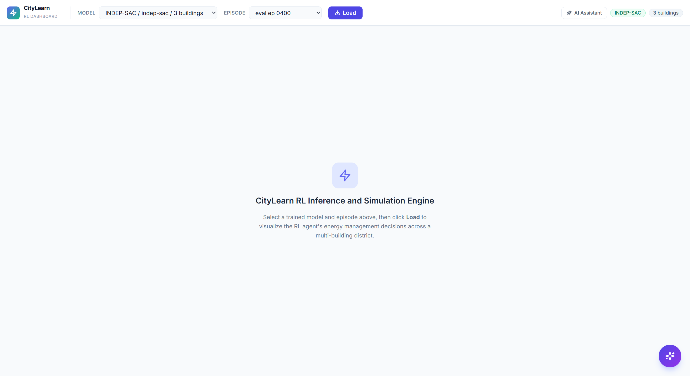
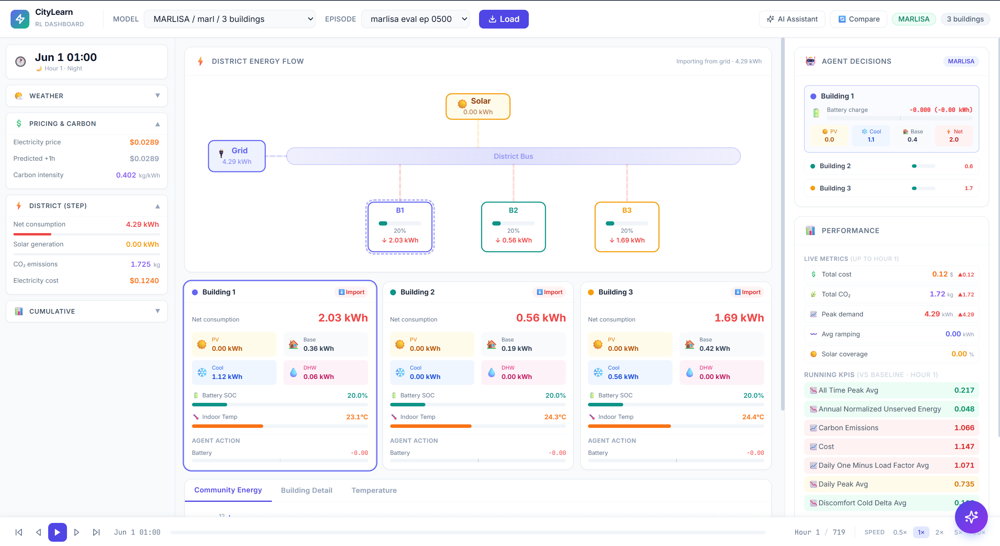
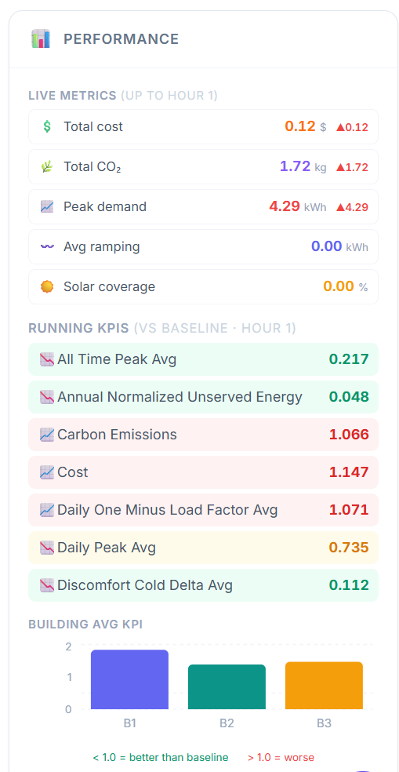
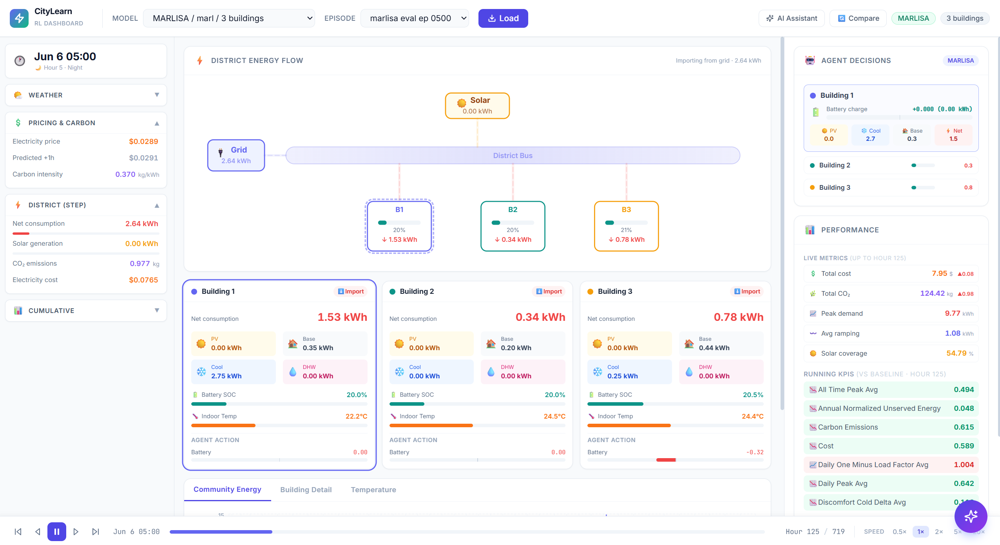
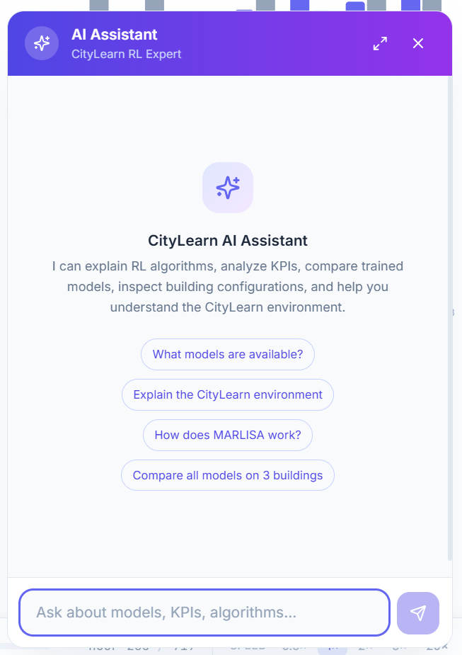

# Technical Documentation

## Smart Cities & Renewable Energy — 5G & Digital Power

CityLearn is dockerized smart city platform uniting Multi-Agent Reinforcement Learning (PyTorch, CityLearn, SAC, MARLISA) for microgrid energy optimization with a real-time 3D 5G Standalone digital twin control plane (free5GC), equipped with custom reward structures to optimize battery storage, carbon emissions, and peak grid demand, while enabling intent-based network orchestration that auto-scales containerized 5G core functions and evaluates 3GPP KPIs in real time.

---

## Table of Contents

- [Introduction](#introduction)
- [System Architecture](#system-architecture)
- [Deployment Overview](#deployment-overview)
- [Part I — RL Energy Optimization](#part-i--rl-energy-optimization)
  - [1. Environment and Problem Setup](#1-environment-and-problem-setup)
  - [2. Multi-Agent RL Formulation](#2-multi-agent-rl-formulation)
  - [3. Coordination Levels](#3-coordination-levels)
  - [4. Reward Engineering](#4-reward-engineering)
  - [5. Experimental Design](#5-experimental-design)
  - [6. Results and Technical Interpretation](#6-results-and-technical-interpretation)
  - [7. Key Takeaways](#7-key-takeaways)
  - [8. Virtual Assistant](#8-virtual-assistant)
  - [9. RL Dashboard UI](#9-rl-dashboard-ui)
  - [10. How to Run — RL Component](#10-how-to-run--rl-component)
- [Part II — 5G Digital Twin](#part-ii--5g-digital-twin)
  - [11. Overview](#11-overview)
  - [12. Key Contributions](#12-key-contributions)
  - [13. Architecture](#13-architecture)
  - [14. 5G KPI Engine](#14-5g-kpi-engine)
  - [15. How to Run — 5G Component](#15-how-to-run--5g-component)
  - [16. Demo Walkthrough](#16-demo-walkthrough)
  - [17. Troubleshooting](#17-troubleshooting)
- [Conclusion](#conclusion)
- [References](#references)

---

## Introduction

This submission integrates two technical streams into one smart-city system:

- A **reinforcement learning (RL) control stream** that optimizes renewable energy usage, cost, carbon emissions, and peak demand across a district of buildings.
- A **5G digital-power stream** that provides reliable, low-latency, and scalable urban connectivity using a live containerized 5G SA core.

Both streams are fully **dockerized**. Every component — from RL training to the dashboard to the full 5G core network — runs in Docker containers and can be deployed with standard `docker compose` commands.

---

## System Architecture

```
+---------------------------+
|   Smart City Scenario     |
| Buildings+PV+Storage+Load |
+-------------+-------------+
              |
     +--------+--------+
     |                  |
     v                  v
+--------------------+  +-----------------------------+
| Part I - RL Energy |  | Part II - 5G Digital Power  |
+--------------------+  +-----------------------------+
|                    |  |                             |
| CityLearn Env      |  | City Control UI             |
|   ^       |        |  |       |                     |
|   |       v        |  |       v                     |
| Multi-Agent RL     |  | State Bridge                |
| (SAC / MARLISA)    |  | /api/buildings -> .txt      |
|       |            |  |       |                     |
|       v            |  |       v                     |
| Energy KPIs        |  | Auto-Scaler                 |
| (cost, carbon,     |  |       |                     |
|  peak, renewable)  |  |       v                     |
|       |            |  | free5GC + UERANSIM + MEC    |
+-------+------------+  |       |                     |
        |                |       v                     |
        |                | 5G KPIs                     |
        |                | (capacity, throughput,      |
        |                |  latency, loss, density)    |
        |                +-------+---------------------+
        |                        |
        +----------+-------------+
                   |
                   v
        +---------------------+
        |  Operations Layer   |
        +---------------------+
        | Unified Dashboard   |
        | Virtual Assistant   |
        +---------------------+
```

---

## Deployment Overview

> **Everything is dockerized.** Each component ships with its own Dockerfile and/or docker-compose configuration. No manual dependency installation is required for deployment — only Docker.

| Component | Container | Dockerfile / Compose | Port |
|---|---|---|---|
| RL Training | `degourdi` conda env | `rl/Dockerfile.huawei` | N/A |
| RL Dashboard (API + UI) | `dashboard` | `rl/Dockerfile.dashboard` + `rl/docker-compose.yml` | 8000 |
| 5G Core (14 NFs) | `mongodb`, `nrf`, `amf`, `smf`, etc. | `5g/free5gc/docker-compose.yml` | 5000, 9090 |
| 5G RAN + Edge (per group) | `gnb-N`, `upf-edge-N`, `mec-node-N` | `5g/free5gc/docker-compose.yml` | — |
| 5G Client (3D UI) | Local dev server | `5g/client/` | 3000 |

### Training on Huawei ModelArts

RL training was performed **locally on an NVIDIA RTX 4070** because the PyTorch version available on Huawei ModelArts at the time of development was outdated and incompatible with the required dependencies (Ray/RLlib 2.38, PyTorch 2.10, CUDA 12.8).

To enable deployment on ModelArts, we provide **`rl/Dockerfile.huawei`** — a Docker image that bundles all up-to-date dependencies (PyTorch 2.10.0, CUDA 12.8, Ray, CityLearn 2.5, etc.) in a single container. This image can be built and pushed to Huawei SWR, then used as a custom image in a ModelArts training job, bypassing the platform's default (outdated) PyTorch environment entirely.

### Gemini API Key (Required for Virtual Assistant)

The virtual assistant uses **Google Gemini 2.5 Flash** via the Agno agent framework. A Gemini API key is required:

1. Go to [Google AI Studio](https://aistudio.google.com/apikey) and generate an API key.
2. Create (or edit) the file `rl/.env`:
   ```
   GEMINI_API_KEY=your-gemini-api-key-here
   ```
3. The key is loaded automatically by both the Docker container and local development server.

A template is provided at `rl/.env.example`.

---

# Part I — RL Energy Optimization

## 1. Environment and Problem Setup

The RL component uses the **CityLearn** simulation platform (v2.5.0) to model a district of grid-interactive buildings, each equipped with:

- rooftop photovoltaic (PV) panels,
- battery energy storage systems,
- cooling and domestic hot water (DHW) devices,
- non-shiftable electrical loads.

Each building is controlled by an independent RL agent that decides, at each hourly timestep, how much energy to charge or discharge from its battery. The collective goal is to optimize district-level KPIs — electricity cost, carbon emissions, peak demand, and renewable self-consumption — while respecting physical constraints (battery capacity, non-negativity, etc.).

### Datasets

Two CityLearn challenge datasets are used:

| Dataset | Buildings | Source |
|---|---|---|
| `citylearn_challenge_2023_phase_2_local_evaluation` | 3 | CityLearn 2023 Phase 2 |
| `citylearn_challenge_2023_phase_3_3` | 6 | CityLearn 2023 Phase 3 |

### Observation and Action Spaces

Each agent observes local building state (battery SOC, net consumption, solar generation, indoor temperature, outdoor weather, time features) through a normalized and clipped observation wrapper.

Each agent outputs a single continuous action in [-1, 1], representing the fraction of available battery capacity to charge (positive) or discharge (negative).

---

## 2. Multi-Agent RL Formulation

The district is modeled as a decentralized partially observable Markov decision process (Dec-POMDP), where:

- each building is an independent agent,
- agents share the same environment but observe only local state,
- the reward signal can be local, shared, or coordination-aware (see Section 4).

### Algorithm: SAC (Soft Actor-Critic)

All models use SAC — an off-policy, entropy-regularized actor-critic algorithm (Haarnoja et al., 2018). SAC maximizes expected return plus an entropy bonus, encouraging exploration and robust policies.

Training configuration:

| Parameter | Value |
|---|---|
| Framework | PyTorch 2.10 |
| Replay buffer | MultiAgentPrioritizedReplayBuffer (1M capacity, alpha=0.6, beta=0.4) |
| Max episodes | 100,000 |
| Evaluation interval | Every 1,000 iterations |
| GPU | 1x NVIDIA RTX 4070 (local) |
| CUDA | 12.8 |

---

## 3. Coordination Levels

Three levels of multi-agent coordination are compared.

### 3.1 Independent SAC

Each building trains its own SAC policy from scratch. No parameter sharing, no coordination signals.

- Strength: simplest setup, no inter-agent dependencies.
- Weakness: no mechanism for cooperative behavior — agents may create conflicting grid peaks.

### 3.2 Shared-Policy SAC

All buildings share one SAC policy network (parameters updated from all buildings' experiences), but execution is decentralized (each building acts from local input).

- Strength: better sample efficiency than fully independent training.
- Weakness: without coordination-aware reward signals, shared parameters alone do not guarantee cooperative district behavior.

### 3.3 MARLISA-Style Coordination

MARLISA-style control adds lightweight coordination context to each agent:

- each agent receives local state plus compact coordination cues,
- these cues help agents anticipate district-level consequences of local actions,
- coordination emerges without requiring a heavy centralized controller.

Coordination variables: `c0` (other agents' demand), `c1` (energy coefficient).

- Strength: improved cooperative decision quality with low extra complexity.
- Weakness: still sensitive to reward design and scenario distribution.

---

## 4. Reward Engineering

Reward design is the central experimental axis of this project. Three reward families are evaluated.

### Why reward engineering is critical in MARL

In multi-agent systems, each agent controls only a local actuator set, but the grid experiences the **sum** of all actions. Reward choice determines whether agents behave as isolated optimizers or cooperative contributors to district stability.

### 4.1 Independent Reward (`indep`)

Each building minimizes its own net consumption objective with no explicit district-level cooperation term.

- Stable local strategies, limited district-level cooperation.
- This is the selfish baseline to test whether algorithmic sharing alone is enough.

### 4.2 Solar Penalty Reward (`solar`)

Extends the independent objective by explicitly discouraging excessive export, so agents learn to retain and shift solar energy more effectively.

- Improved renewable usage patterns.
- Introduces a stronger renewable-centric incentive while remaining decentralized.

### 4.3 MARL Reward (`marl`)

Directly emphasizes district-level outcomes (smoother aggregate load, lower stress peaks, better global energy behavior), so local actions are aligned with collective performance.

- Better collective behavior, lower district stress.
- Agents avoid synchronized charge/discharge that creates demand spikes.

### Intuition across the three rewards

1. `indep`: "Help my own building."
2. `solar`: "Help my own building and avoid poor PV export behavior."
3. `marl`: "Act so the whole district behaves better."

### Why Reward-Isolated Comparison Is Mandatory

Comparing different algorithms under different rewards is not a fair test. This study compares models only within reward-matched groups:

- `indep` group: Indep SAC vs Shared SAC
- `solar` group: Shared SAC vs MARLISA
- `marl` group: Shared SAC vs MARLISA

---

## 5. Experimental Design

**Benchmarks:**

- 3-building district: `citylearn_challenge_2023_phase_2_local_evaluation`
- 6-building district: `citylearn_challenge_2023_phase_3_3` (scalability test)

**Run matrix:**

| Algorithm | Reward | Buildings |
|---|---|---|
| Indep SAC | indep | 3 |
| Shared SAC | indep | 3 |
| Shared SAC | solar | 3 |
| Shared SAC | marl | 3 |
| MARLISA | solar | 3 |
| MARLISA | marl | 3 |
| MARLISA | marl | 6 |

**Artifacts:** Training curves (TensorBoard reward traces), final KPI snapshots (district-level CityLearn exports).

---

## 6. Results and Technical Interpretation

### 6.1 Independent Reward


This section tests whether policy sharing alone helps when incentives remain selfish. Similar trends indicate that reward structure, not only parameter sharing, drives district behavior.

### 6.2 Solar Penalty Reward


Under a solar-focused incentive, MARLISA-style coordination improves quality of control decisions. Gains appear in evaluation KPIs even when learning curves are close.

### 6.3 MARL Reward


Coordination-focused reward plus coordination-aware policy structure is the strongest combination in this study.

### 6.4 Scalability (MARLISA, MARL Reward)


The best configuration is transferred from 3 to 6 buildings. Results suggest the approach scales without requiring a new control architecture.

---

## 7. Key Takeaways

1. Reward design is the dominant factor in district-level behavior quality.
2. Shared learning improves efficiency, but does not automatically produce cooperation.
3. Lightweight coordination signals provide meaningful gains without full centralization.
4. The MARLISA + MARL reward setting is the strongest candidate for larger districts.

---

## 8. Virtual Assistant

The platform includes a conversational assistant that serves as an expert analyst for the CityLearn RL system. It makes trained models, KPI results, and algorithmic concepts accessible through natural language interaction.

**Stack:** Google Gemini 2.5 Flash LLM via the Agno agent framework (v1.2.6), integrated into the FastAPI backend at `POST /api/chat`.

**Requires:** `GEMINI_API_KEY` in `rl/.env` (see [Deployment Overview](#deployment-overview)).

### Interaction Flow

1. The user sends a natural language query via the chat panel.
2. The FastAPI backend (`POST /api/chat`) forwards the message to the Agno agent.
3. The agent calls the appropriate tool(s) to fetch actual platform data before answering.
4. Tool functions execute against the model discovery layer (`config.py`) and episode data loader (`data.py`), returning structured JSON internally.
5. The agent synthesizes tool outputs into narrative prose with headings, bullet points, and bold highlights.
6. The response is returned to the frontend, rendered with Markdown support and tool call badges.

### Available Tools

| Tool | Purpose |
|---|---|
| `list_trained_models` | Catalog all discovered models with algorithm, reward, episodes, checkpoints |
| `get_model_details` | Full metadata and training config for a specific model |
| `get_episode_kpis` | Normalized KPI metrics for a given episode |
| `get_episode_summary` | Timeseries summary statistics (consumption, solar, CO2, cost, per-building battery usage) |
| `compare_models` | Cross-algorithm KPI comparison on the same dataset |
| `get_building_info` | Per-building equipment specs (PV, battery, cooling, DHW) |
| `get_dataset_info` | Dataset schema, building list, simulation parameters |
| `explain_citylearn` | Explanation of the CityLearn environment |
| `explain_algorithm` | Detailed explanation of SAC, MARLISA, or RBC |
| `get_baseline_comparison` | Side-by-side KPI comparison of an RL model vs. a baseline agent |

### Guardrails

- **Data-grounded responses**: The system prompt mandates that the agent call tools to fetch actual numbers before answering performance questions, preventing hallucinated metrics.
- **Clean output**: A post-processing pipeline strips raw JSON artifacts and tool-call noise from agent responses before they reach the frontend.
- **Structured formatting**: Enforced response style — one-sentence summary lead, organized headings, bullet points, bold highlights for key numbers, and a closing takeaway. KPI values are always contextualized (e.g., "a cost KPI of **0.82** means an **18% reduction** vs. baseline").
- **Tool call transparency**: Each tool invocation is surfaced in the chat UI as a labeled badge with a contextual icon.

---

## 9. RL Dashboard UI

**Stack:** Vite + React 18 + Recharts + Tailwind CSS 3, served by FastAPI via `Dockerfile.dashboard`.

### Screenshots

**Landing State: Model and Episode Selection**



The header bar shows a model selector dropdown (listing all discovered models in `ALGORITHM / reward_variant / N buildings` format), an episode selector, and a Load button.

---

**Main Dashboard: Three-Panel Layout**



Three-column layout: left sidebar (environment controls, building selection, dataset info, available baselines); center panel (energy flow Sankey diagram, building grid with per-building state cards, community-level consumption/solar timeseries charts); right panel (KPI panel with six normalized metric cards and a bar chart, agent information panel).

---

**Building Grid: Per-Building State Cards**


Each card shows building name, real-time battery SOC, net consumption, and indoor temperature. Color-coded based on metric values.

---

**Energy Flow: Sankey Diagram**


Shows how energy moves through the district at each timestep — from solar generation through battery storage to grid import/export.

---

**Community Charts: District-Level Timeseries**


Net consumption over time, solar generation overlay, and peak demand indicators across the full episode.

---

**KPI Panel: Performance Metrics**



Six normalized performance metrics: cost, carbon emissions, electricity consumption, peak demand, daily peak, load factor, and ramping. Each card is color-coded (green when < 1.0, indicating the RL agent outperforms the no-op baseline).

---

**Playback Bar: Timeline Scrubber**



Bottom-docked playback controls: play/pause, speed adjustment, timeline scrubber, timestamp display. Enables animated replay of the full episode.

---

**Comparison Mode: Model vs. Baseline**


Side-by-side KPI tables comparing the loaded RL model against a baseline agent (no-op or RBC). Delta calculations highlight improvements or regressions.

---

**Chat Panel (Popup Mode)**



Floating chat panel with user/assistant message bubbles, Markdown-rendered responses, and tool call badges.

---

**Chat Panel (Fullscreen Mode)**


Fullscreen chat mode replacing the main dashboard content for extended analytical conversations.

---

## 10. How to Run — RL Component

All RL components are dockerized. The two main Docker images are:

| Image | Dockerfile | Purpose |
|---|---|---|
| Training environment | `rl/Dockerfile.huawei` | Full training stack (PyTorch 2.10, CUDA 12.8, Ray/RLlib, CityLearn) |
| Dashboard (API + UI) | `rl/Dockerfile.dashboard` | FastAPI backend + React frontend in one container |

### 10.1 Running the Dashboard (Recommended — Single Command)

```bash
cd rl/

# Create your .env file with the Gemini API key
cp .env.example .env
# Edit .env and add your Gemini API key from https://aistudio.google.com/apikey

# Build and start the dashboard
docker compose up -d --build
```

The dashboard is accessible at **http://localhost:8000**.

This single container serves:
- The React UI (static build)
- The FastAPI REST API (`/api/*` endpoints)
- The virtual assistant (`POST /api/chat`)

### 10.2 Running RL Training

Training was performed locally on an NVIDIA RTX 4070. Training is done through the Jupyter notebooks provided in `rl/notebooks/`. To set up the environment:

```bash
cd rl/

# Create conda environment
conda create -n degourdi python=3.11
conda activate degourdi

# Install dependencies
pip install -r requirements.txt
pip install torch --index-url https://download.pytorch.org/whl/cu124
```

Then open and run the training notebooks in `rl/notebooks/`.

Training artifacts are saved to `rl/outputs/<algorithm>/<reward>/<dataset_size>/`:
- `checkpoints/` — RLlib saved checkpoints
- `schemas/` — CityLearn schema overrides for evaluation
- `ui_exports/` — Episode data with `exported_kpis.csv` for dashboard visualization

A ModelArts-compatible Docker image is available at **`rl/Dockerfile.huawei`**, which bundles all up-to-date dependencies and can be used as a custom image in a ModelArts training job.

### 10.4 API Endpoints Reference

| Method | Endpoint | Description |
|---|---|---|
| `GET` | `/api/catalog` | All trained models |
| `GET` | `/api/models/{algo}/{reward}/{size}/episodes` | Episode list for a model |
| `GET` | `/api/models/{algo}/{reward}/{size}/episodes/{episode}` | Full episode data |
| `GET` | `/api/datasets/{dataset_name}/schema` | Dataset schema |
| `GET` | `/api/baselines/{dataset_size}` | Available baseline agents |
| `GET` | `/api/baselines/{dataset_size}/{agent_type}` | Run a baseline agent |
| `GET` | `/api/compare/{dataset_size}` | Cross-model KPI comparison |
| `POST` | `/api/chat` | Virtual assistant (requires Gemini API key) |
| `GET` | `/api/health` | Health check |

---

# Part II — 5G Digital Twin

## 11. Overview

The 5G component is a real-time infrastructure digital twin that scales with the city. While most digital twins are purely visual, this platform's 3D environment acts as a **live control plane**. Modifying the number of smart city buildings in the UI automatically provisions and deprovisions Docker containers running the 5G infrastructure — the 5G Standalone (SA) core from free5GC, gNB simulators using UERANSIM, and custom MEC nodes.

Simultaneously, a **physics-based 5G KPI engine** computes five core network metrics in real time using 3GPP-specified formulas — peak cell capacity, average UE throughput, per-slice latency, packet loss, and connection density — every time the building configuration changes.

The solution provides an optimized 5G architecture for smart city use cases involving up to 20 buildings as a proof of concept, ensuring that the resulting KPIs satisfy key 5G performance constraints.


**Stack:**

| Layer | Technology |
|---|---|
| 3D Visualization | React 19 + react-three-fiber + Three.js + Framer Motion |
| 5G Core | free5GC v3 (AMF, SMF, UPF, NRF, AUSF, UDM, PCF, NSSF) |
| RAN Simulator | UERANSIM gNB x3 (one per slice) |
| Edge Compute | Custom MEC nodes co-located per gNB |
| Infra Orchestration | Docker Compose + Bash auto-scaler |
| State Bridge | CRA setupProxy.js middleware — no separate backend |

---

## 12. Key Contributions

1. **Zero-backend infrastructure bridge** — The React dev-server middleware (`setupProxy.js`) intercepts `POST /api/buildings`, atomically writes `state/buildings.txt`, and the watching shell script provisions Docker containers. No Express server, no database, no message queue needed.

2. **Real-time 3GPP-compliant KPI engine** — All five KPIs are derived from closed-form 3GPP formulas (TS 38.306, TR 38.913, TS 38.214), not mock data. Changing one building updates all KPIs within the same React render cycle.

3. **Demand-driven 5G infrastructure scaling** — The city UI is the actual control plane. Slider to file to Docker: the 5G infrastructure responds to UI events, demonstrating intent-based network management.

4. **Optimised radio parameters** — 64T64R Massive MIMO, 8-layer MU-MIMO spatial multiplexing, 256-QAM, DDDSU TDD frame, n78 100 MHz producing a verified **3,472 Mbps peak per gNB**, **2.1 ms eMBB latency**, and **0.879 ms URLLC latency**.

---

## 13. Architecture

### System Diagram

```
+================================================================+
|                   React App (port 3000)                        |
|                                                                |
|  3D City Scene -----> compute5GKPIs() -----> 5G KPI Dashboard  |
|  (slider 1-20)              |               (3GPP formulas)   |
|       |                     |                                  |
|       v                     |                                  |
|  POST /api/buildings        |                                  |
|       |                     |                                  |
|       v                     |                                  |
|  setupProxy.js              |                                  |
|  (atomic write -> state/buildings.txt)                         |
+===========================|====================================+
                            |
                            v
                   File watcher (3s poll)
                            |
                            v
+================================================================+
|               scale_network.sh --watch                         |
|                                                                |
|  buildings.txt --> compute groups (1-3)                         |
|                         |                                      |
|            +------------+------------+                         |
|            |            |            |                         |
|            v            v            v                         |
|     docker start  docker start  docker start                   |
|       gnb-N       upf-edge-N    mec-node-N                    |
+========|================|============|=========================+
         |                |            |
         v                v            v
+================================================================+
|                free5GC Docker Compose                          |
|                                                                |
|  Always-on Core (14 containers)                                |
|  +----------------------------------------------------------+ |
|  | mongodb  nrf   ausf  udr  udm  pcf  nssf  bsf            | |
|  | amf      smf   upf-central   webui   prometheus           | |
|  +----------------------------------------------------------+ |
|                                                                |
|  Group 1 (buildings 1-8, eMBB)                                 |
|  +----------------------------------------------------------+ |
|  | ueransim-gnb-1   free5gc-upf-edge-1   mec-node-1         | |
|  +----------------------------------------------------------+ |
|                                                                |
|  Group 2 (buildings 9-16, URLLC)                               |
|  +----------------------------------------------------------+ |
|  | ueransim-gnb-2   free5gc-upf-edge-2   mec-node-2         | |
|  +----------------------------------------------------------+ |
|                                                                |
|  Group 3 (buildings 17-20, mMTC)                               |
|  +----------------------------------------------------------+ |
|  | ueransim-gnb-3   free5gc-upf-edge-3   mec-node-3         | |
|  +----------------------------------------------------------+ |
+================================================================+
```

### 5G Network Design

Architecture: **5G Standalone (SA)** + **Multi-access Edge Computing (MEC)** + **Network Slicing**

| Network Function | Role |
|---|---|
| AMF | Access and Mobility Management |
| SMF | Session Management — selects edge UPF per slice |
| UPF central | Always-on traffic anchor |
| UPF edge 1-3 | Local breakout at gNB site, < 2 ms MEC latency |
| NRF | Service discovery for all NFs |
| AUSF / UDM / UDR | Authentication and subscriber data |
| PCF / NSSF | Policy and slice selection |
| UERANSIM gNB | Simulated NR base station (one per 8 buildings) |
| MEC node | Edge compute co-located with gNB (Nginx container) |

**Three network slices (3GPP TS 23.501):**

| Slice | SST | Use Case | Latency Target | Reliability |
|---|---|---|---|---|
| eMBB | 1 | Dashboards, video | < 4 ms | 99.99% |
| URLLC | 2 | Grid control, safety | < 1 ms | 99.999% |
| mMTC | 3 | IoT sensors, meters | < 10 ms | -- |

### Data Flow

```
[React slider] --> useState(buildingCount)
   --> useBuildingSync (debounce 500ms, AbortController)
         --> POST /api/buildings  { buildings: N }
               --> setupProxy.js (Express middleware inside npm start)
                     --> atomic write --> ./state/buildings.txt
                           --> scale_network.sh --watch (polls every 3s)
                                 --> docker start/stop containers
```

### Scaling Table

Per **3GPP TR 38.913** urban micro-cell, one gNB per 8 buildings (ISD ~300 m):

| Buildings | Active gNBs | Edge UPFs | MEC Nodes | Containers Started |
|---|---|---|---|---|
| 0 | 0 | 0 | 0 | -- |
| 1-8 | 1 | 1 | 1 | Group 1 (3 containers) |
| 9-16 | 2 | 2 | 2 | Groups 1+2 (6 containers) |
| 17-20 | 3 | 3 | 3 | Groups 1+2+3 (9 containers) |

### Docker Network Layout

| Network | Subnet | Purpose |
|---|---|---|
| n2net | 10.200.200.0/24 | N2 interface (RAN to AMF) |
| n3net | 10.200.201.0/24 | N3 interface (gNB to UPF) |
| n4net | 10.200.202.0/24 | N4 interface (SMF to UPF) |
| n6net | 10.200.203.0/24 | N6 interface (UPF to data network) |
| sba | 10.200.100.0/24 | Service-Based Architecture |
| mecnet | 10.200.204.0/24 | MEC network |

---

## 14. 5G KPI Engine

All KPIs are computed in `HomePage.jsx` using the `PHY` constants object and five pure functions. Values update on every `buildingCount` change within a single React `useMemo` call.

**Radio configuration (optimised):**

| Parameter | Value | Specification |
|---|---|---|
| Band | n78 (3.3-3.8 GHz TDD) | 3GPP TS 38.101-1 |
| Channel BW | 100 MHz | -- |
| Numerology | mu=1, SCS=30 kHz | 3GPP TS 38.211 |
| PRBs | 273 | 3GPP TS 38.101-1 Table 5.3.2-1 |
| MIMO | 64T64R gNB / 4T4R UE | -- |
| DL layers | 8 (MU-MIMO ZF) | 3GPP TR 38.306 |
| Modulation | 256-QAM (Q_m=8) | -- |
| Max code rate | R_max = 948/1024 | 3GPP TS 38.214 Table 5.1.3.1-2 |
| TDD DL ratio | 74.3% (DDDSU) | 3GPP TR 38.211 |
| Scheduler efficiency | 78% | 3GPP system-level sims |

### KPI 1: Cell Capacity

**Formula (3GPP TR 38.306 s4.1.2):**

```
R_peak = layers x Q_m x R_max x N_RB x 12 x f_slot x TDD_DL x (1 - OH_DL)
```

where layers=8, f_slot=2000 slots/s (mu=1), OH_DL=14% overhead.

**Result:** 3,472 Mbps peak per gNB, 2,708 Mbps effective (x0.78 scheduler efficiency)

### KPI 2: Average UE Throughput

**Formula:**

```
T_avg  = (C_eff / N_active) x G_PF
G_PF   = 1 + 0.40 x ln(N_active) / ln(100)
```

Proportional-Fair scheduler multi-user diversity gain. N_active = buildings x 50 devices x 10% active ratio.

### KPI 3: Latency

**Composed formula (one-way UE to MEC):**

```
L_total = T_prop + T_tx + T_proc + T_queue

T_prop  = (ISD/2)/c + T_fiber          [propagation + fiber hop]
T_tx    = T_slot = 0.5 ms              [2-sym mini-slot for URLLC = 0.071 ms]
T_proc  = N2 x T_sym + T_MEC           [gNB decode + edge compute]
T_queue = T_slot x rho / (2(1-rho))    [M/D/1 queuing model]
```

**Results:**

| Slice | Total Latency |
|---|---|
| eMBB | 2.117 ms |
| URLLC | 0.879 ms |
| mMTC | ~3 ms |

### KPI 4: Packet Loss

**Formula:**

```
P_loss    = P_HARQ + P_overflow
P_HARQ    = BLER_0 ^ H_rounds          [Chase-Combining HARQ residual]
P_overflow = 0         for rho < 0.80
           = (rho-0.80)^2 x 5          for rho >= 0.80
```

**Results:** eMBB = 0.0100% (4 HARQ rounds), URLLC = 0.1000% (single shot)

### KPI 5: Connection Density

**Formula:**

```
rho_conn = N_connected / (gNBs x A_hex)
A_hex    = (sqrt(3)/2) x ISD^2         [hexagonal cell area, ISD=300m]
```

**Result:** 3,935 UE/km^2 at 20 buildings / 3 gNBs. Max theoretical 10^6 UE/km^2 (mMTC per 3GPP TR 38.913).

---

## 15. How to Run — 5G Component

The 5G component consists of three parts: the React 3D client, the free5GC core network (all dockerized), and the auto-scaler script.

### Prerequisites

| Requirement | Version | Notes |
|---|---|---|
| Node.js | 18+ | For React app |
| npm | 9+ | -- |
| Docker | 24+ | With Compose v2 plugin |
| bash | 4+ | For scale script |
| RAM | 8 GB minimum | free5GC core uses ~4 GB |
| OS | Linux | free5GC requires Linux kernel with GTP module |

### Step 1: Start the React 3D Client

```bash
cd 5g/client/
npm install
npm install http-proxy-middleware
npm start
```

Expected console output confirming the state bridge is active:
```
[citylearn-5g] proxy ready -- state file: /path/to/client/state/buildings.txt
```

The app is available at **http://localhost:3000**.

### Step 2: Launch the 5G Core (Dockerized)

```bash
cd 5g/free5gc/

# Create all containers without starting them
docker compose up --no-start

# Start the always-on 5G core (14 containers)
docker compose up -d mongodb nrf ausf udr udm pcf nssf bsf \
                      amf smf upf-central webui prometheus

# Wait for NRF service discovery to complete
sleep 15 && docker compose ps
```

**free5GC WebUI:** http://localhost:5000
**Prometheus:** http://localhost:9090

### Step 3: Start the Auto-Scaler

```bash
cd 5g/free5gc/

# Watch buildings.txt and scale Docker containers automatically
./scale.sh --watch --file /absolute/path/to/5g/client/state/buildings.txt
```

The scaler polls `buildings.txt` every 3 seconds. When the building count crosses a group boundary (8, 16), it starts or stops the corresponding gNB + UPF + MEC container group.

### Step 4: Verify the Full Pipeline

```bash
# Test the bridge without touching the UI
curl -s -X POST http://localhost:3000/api/buildings \
     -H "Content-Type: application/json" \
     -d '{"buildings": 12}' | python3 -m json.tool

# Expected: { "buildings": 12, "synced": true }

# Verify state file
cat 5g/client/state/buildings.txt
# Expected: 12

# Wait 3-6s then check Docker
docker ps --format "table {{.Names}}\t{{.Status}}" | grep -E "gnb|upf-edge|mec"
# Expected: ueransim-gnb-1, free5gc-upf-edge-1, mec-node-1 (and -2) running
```

---

## 16. Demo Walkthrough

1. **Drag the Buildings slider** (top-center) — the 3D city updates instantly.
2. **Watch the KPI Dashboard** (left panel) — all five 5G KPIs recalculate in real time. Hover any KPI block to expand its formula.
3. **Observe Docker** — within 3-6 seconds of crossing a group boundary (8 or 16 buildings), gNB + UPF + MEC containers start or stop.
4. **Click any building** — the right panel shows per-building KPIs with full latency breakdown.
5. **Open the "5G Arch" modal** — complete formula reference and slice specifications.

**Key thresholds:**

| Slider Position | gNBs | Docker Action |
|---|---|---|
| 1-8 buildings | 1 gNB | Group 1 starts (3 containers) |
| 9-16 buildings | 2 gNBs | Group 2 starts (+3 containers) |
| 17-20 buildings | 3 gNBs | Group 3 starts (+3 containers) |
| Decreasing | Fewer gNBs | Groups stop in reverse order |

---

## 17. Troubleshooting

**setupProxy.js not activating**
```bash
npm install http-proxy-middleware
# Restart npm start and look for:
# [citylearn-5g] proxy ready -- state file: ...
```

**5G Core NFs failing to register with NRF**
```bash
docker logs free5gc-nrf --tail 30
# Wait 15-20s after startup before starting AMF/SMF
```

**Scale script not picking up changes**
```bash
cat client/state/buildings.txt   # Verify content
chmod +x scale_network.sh        # Ensure execute permission
```

**URLLC latency shows > 1 ms**
This is expected at high building counts where queue load rho > 0.1. The architecture target of < 1 ms assumes dedicated URLLC resource blocks with zero shared-queue contention.

---

## Conclusion

These two parts form one integrated submission: RL provides district energy optimization decisions, and 5G provides the resilient city-scale network layer needed to operationalize smart services. Together they deliver better renewable energy behavior, scalable urban infrastructure, and mobility-ready connectivity.

---

## References

1. Vazquez-Canteli et al. MARLISA: Multi-Agent RL with Iterative Sequential Action Selection. BuildSys, 2021.
2. Vazquez-Canteli and Nagy. CityLearn v1.0: An OpenAI Gym Environment for Demand Response. BuildSys, 2019.
3. Haarnoja et al. Soft Actor-Critic: Off-Policy Maximum Entropy Deep RL. ICML, 2018.
4. Nweye et al. CityLearn 2022 Challenge: Citywide MARL for Demand Response. NeurIPS Competition, 2022.
5. Nweye et al. CityLearn v2: A Multi-Agent Reinforcement Learning Environment for Home Energy Management and Demand Response. arXiv:2405.03848, 2024.
6. CityLearn Documentation: https://www.citylearn.net/
7. 3GPP TS 38.306 — NR User Equipment (UE) radio access capabilities.
8. 3GPP TR 38.913 — Study on scenarios and requirements for next generation access technologies.
9. 3GPP TS 38.214 — NR Physical layer procedures for data.
10. 3GPP TS 23.501 — System architecture for the 5G System (5GS).
11. free5GC: https://free5gc.org/
12. UERANSIM: https://github.com/aligungr/UERANSIM
