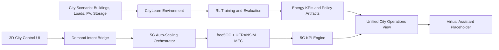

# Huawei DeGourdi Hackathon Submission

## Smart Cities and Renewable Energy: AI, 5G and Digital Power

## 1. Submission Summary

This project delivers an integrated smart-city solution that combines:

1. AI-based district energy optimization using multi-agent reinforcement learning (CityLearn).
2. A live 5G digital twin that scales infrastructure and tracks telecom KPIs in real time.
3. A virtual LLM assistant track (intentionally left as placeholder for now).

Our objective is to improve renewable energy usage and city-scale service reliability while keeping the system practical for real urban operations.

## 2. Problem We Address

Modern cities face two connected bottlenecks:

- Energy bottleneck: distributed solar, storage, and demand are hard to coordinate at district level.
- Connectivity bottleneck: mobility and public services require low latency, high reliability, and scalable 5G capacity.

Treating these domains separately creates suboptimal outcomes. Our approach unifies them in one operational narrative.

## 3. Our Integrated Approach

### AI Layer: Renewable-Aware District Control

- We model each building as an intelligent agent in CityLearn.
- Agents learn storage actions (cooling, DHW, battery) to reduce cost, carbon, and peak demand.
- We compare Independent SAC, Shared Policy SAC, and MARLISA-style coordination under fair reward-matched evaluation.

### 5G Layer: Digital Power and Mobility Backbone

- A city UI drives infrastructure demand using building count as control intent.
- The 5G stack auto-scales gNB + UPF + MEC resources.
- A KPI engine computes capacity, throughput, latency, packet loss, and connection density using 3GPP-aligned formulations.

### Digital Services Layer

- A virtual assistant module is reserved for city operators and citizens.
- This section is intentionally not filled yet (as requested).

## 4. Alignment with Hackathon Focus Areas

| Focus Area | Submission Contribution |
|---|---|
| Renewable energy integration | RL reward engineering improves solar self-consumption and district-level energy behavior. |
| Sustainable urban infrastructure | Joint energy-control + network-scaling architecture for district operations. |
| Intelligent mobility | Slice-aware 5G design (eMBB, URLLC, mMTC) with real KPI tracking. |
| Digital public services | Operator-facing dashboards and service observability; assistant track reserved for next step. |

## 5. High-Level Architecture

## 6. Key Technical Outcomes

### RL track outcomes

- Reward design is the strongest determinant of cooperative district behavior.
- MARLISA-style coordination with cooperative reward (`marl`) is the best-performing setting in our study.
- The approach remains effective when moving from 3-building to 6-building evaluation.

### 5G track outcomes

- Peak cell capacity: 3,472 Mbps per gNB (2,708 Mbps effective).
- eMBB one-way latency: 2.117 ms.
- URLLC one-way latency: 0.879 ms.
- Connection density at 20 buildings: 3,935 UE/km^2.

## 7. Why This Is Novel

1. End-to-end coupling of energy intelligence and communications infrastructure in one city workflow.
2. Fair RL benchmarking with strict reward-isolated comparison across algorithms.
3. Practical 5G operations model where UI demand directly triggers infrastructure scaling.
4. KPI-first engineering: both energy and network quality are measured, not assumed.

## 8. Demo Story (Submission Narrative)

1. Start from a baseline district scenario.
2. Show AI-driven energy policy behavior and district KPI effects.
3. Increase building count in the city UI.
4. Observe automatic 5G infrastructure scaling (gNB/UPF/MEC groups).
5. Track real-time 5G KPI updates and discuss service implications for mobility/public services.

## 9. Current Scope and Next Steps

In scope now:

- RL optimization track (implemented)
- 5G digital twin track (implemented)
- Unified technical documentation (implemented)

Next iteration:

- Fill virtual assistant architecture and guardrails
- Expand experiments to larger districts and broader service scenarios
- Add forecast-aware decision support for tariffs, weather, and occupancy uncertainty

## 10. Submission Assets

- Global contribution/process notes: [docs/CONTRIBUTION.md](./docs/CONTRIBUTION.md)
- RL technical documentation: [docs/RL.md](./docs/RL.md)
- 5G technical documentation: [docs/5G.md](./docs/5G.md)

Core implementation directories:

- `rl/` for AI energy optimization and dashboard APIs
- `5g/` for 5G digital twin client and free5GC infrastructure
