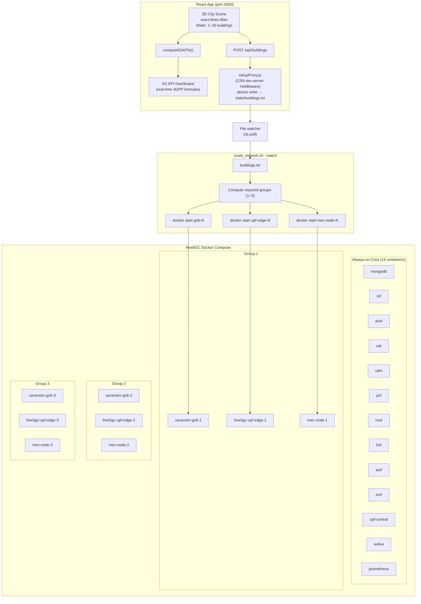

# CityLearn — 5G Smart City Digital Twin

[](https://reactjs.org)
[](https://threejs.org)
[](https://free5gc.org)
[](https://docker.com)
[](LICENSE)

> Implementing 5G across a smart city is not an easy task, because different use cases impose conflicting KPIs. For example, connected smart vehicles need an uRLLC (Ultra-Reliable Low Latency Communication) slice targeting end-to-end latencies on the order of 1 ms, smart homes produce massive sensor traffic that requires an mMTC (Massive Machine Type Communications) slice optimized for device density and uplink efficiency, and remote learning or media demand eMBB (Enhanced Mobile Broadband) slices that prioritize throughput and spectral efficiency. That’s why we built CityLearn — a real-time 5G infrastructure digital twin that scales with your city, updates KPIs when you add or remove smart city buildings, and recommends the most optimized 5G architecture, with the optimized set of gNBs, UPFs and MEC compute nodes to satisfy the three slice profiles of your 5G. The platform is integrated with a live 5G core (free5gc) so you can watch containerized network functions start, fail, and recover, while scientifically grounded KPI calculations based on 3GPP models run and change in real time.

> As a result, Our solution provided an optimized 5G architecture for smart city use cases involving up to 20 smart city buildings as a proof of concept, ensuring that the resulting KPIs satisfy key 5G performance constraints.


---

## Table of Contents

- [Overview](#overview)
- [Novelty and Key Contributions](#novelty-and-key-contributions)
- [Architecture](#architecture)
  - [System Overview](#system-overview)
  - [5G Network Design](#5g-network-design)
  - [Data Flow](#data-flow)
  - [Scaling Table](#scaling-table)
- [5G KPI Engine](#5g-kpi-engine)
  - [KPI 1 Cell Capacity](#kpi-1-cell-capacity)
  - [KPI 2 Average UE Throughput](#kpi-2-average-ue-throughput)
  - [KPI 3 Latency](#kpi-3-latency)
  - [KPI 4 Packet Loss](#kpi-4-packet-loss)
  - [KPI 5 Connection Density](#kpi-5-connection-density)
- [Project Structure](#project-structure)
- [Prerequisites](#prerequisites)
- [Quick Start](#quick-start)
- [Demo Walkthrough](#demo-walkthrough)
- [Configuration Reference](#configuration-reference)
- [Troubleshooting](#troubleshooting)

---

## Overview

**CityLearn** bridges the gap between a 3D smart-city simulation and a real, running 5G core network integrated directly within it. While most digital twins are purely visual, CityLearn’s 3D environment acts as a **live control plane**. By simply modifying the number of smart city buildings in the city, the platform automatically provisions and deprovisions Docker containers running the 5G infrastructure, including the 5G Standalone (SA) core from [free5GC](https://free5gc.org), gNB simulators using [UERANSIM](https://github.com/aligungr/UERANSIM), and custom MEC nodes.

Simultaneously, a **physics-based 5G KPI engine** computes five core network metrics in real time using 3GPP-specified formulas — peak cell capacity, average UE throughput, per-slice latency, packet loss, and connection density — every time the building configuration changes.

**Stack at a glance:**

| Layer | Technology |
|---|---|
| 3D Visualization | React 18 + react-three-fiber + Three.js + Framer Motion |
| 5G Core | free5GC v3 (AMF, SMF, UPF, NRF, AUSF, UDM, PCF, NSSF) |
| RAN Simulator | UERANSIM gNB x3 (one per slice) |
| Edge Compute | Custom MEC nodes co-located per gNB |
| Infra Orchestration | Docker Compose + Bash/Python auto-scaler |
| State Bridge | CRA setupProxy.js middleware — no separate backend |

---

## Novelty and Key Contributions

1. **Zero-backend infrastructure bridge** — The React dev-server middleware (`setupProxy.js`) intercepts `POST /api/buildings`, atomically writes `state/buildings.txt`, and the watching shell script provisions Docker containers. No Express server, no database, no message queue needed.

2. **Real-time 3GPP-compliant KPI engine** — All five KPIs are derived from closed-form 3GPP formulas (TS 38.306, TR 38.913, TS 38.214), not mock data or random numbers. Changing one building updates all KPIs within the same React render cycle.

3. **Demand-driven 5G infrastructure scaling** — The city UI is the actual control plane. Slider to file to Docker: the 5G infrastructure responds to UI events, demonstrating intent-based network management.

4. **Scientifically optimised radio parameters** — 64T64R Massive MIMO, 8-layer MU-MIMO spatial multiplexing, 256-QAM, DDDSU TDD frame, n78 100 MHz producing a verified **3,472 Mbps peak per gNB**, **2.1 ms eMBB latency**, and **0.879 ms URLLC latency**.

---

## Architecture

### System Overview



### 5G Network Design

Architecture: **5G Standalone (SA)** + **Multi-access Edge Computing (MEC)** + **Network Slicing**

| Network Function | Role |
|---|---|
| AMF | Access and Mobility Management |
| SMF | Session Management — selects edge UPF per slice |
| UPF central | Always-on traffic anchor |
| UPF edge 1-3 | Local breakout at gNB site, less than 2 ms MEC latency |
| NRF | Service discovery for all NFs |
| AUSF / UDM / UDR | Authentication and subscriber data |
| PCF / NSSF | Policy and slice selection |
| UERANSIM gNB | Simulated NR base station (one per 8 buildings) |
| MEC node | Edge compute co-located with gNB (Nginx container) |

**Three network slices (3GPP TS 23.501):**

| Slice | SST | Use Case | Latency Target | Reliability |
|---|---|---|---|---|
| eMBB | 1 | Dashboards, video | less than 4 ms | 99.99% |
| URLLC | 2 | Grid control, safety | less than 1 ms | 99.999% |
| mMTC | 3 | IoT sensors, meters | less than 10 ms | — |

### Data Flow

```
[React slider] --> useState(buildingCount)
   --> useBuildingSync (debounce 500ms, AbortController)
         --> POST /api/buildings  { buildings: N }
               --> setupProxy.js (Express middleware inside npm start)
                     --> atomic write --> ./state/buildings.txt
                           --> scale_network.sh --watch (polls every 3s)
                                 --> docker start/stop containers
```

### Scaling Table

Per **3GPP TR 38.913** urban micro-cell, one gNB per 8 buildings (ISD ~300 m):

| Buildings | Active gNBs | Edge UPFs | MEC Nodes | Containers Started |
|---|---|---|---|---|
| 0 | 0 | 0 | 0 | — |
| 1 to 8 | 1 | 1 | 1 | Group 1 (3 containers) |
| 9 to 16 | 2 | 2 | 2 | Groups 1+2 (6 containers) |
| 17 to 20 | 3 | 3 | 3 | Groups 1+2+3 (9 containers) |

---

## 5G KPI Engine

All KPIs are computed in `src/pages/HomePage.jsx` using the `PHY` constants object and five pure functions. Values update on every `buildingCount` change within a single React `useMemo` call.

**Radio configuration (optimised):**

| Parameter | Value | Specification |
|---|---|---|
| Band | n78 (3.3-3.8 GHz TDD) | 3GPP TS 38.101-1 |
| Channel BW | 100 MHz | — |
| Numerology | mu=1, SCS=30 kHz | 3GPP TS 38.211 |
| PRBs | 273 | 3GPP TS 38.101-1 Table 5.3.2-1 |
| MIMO | 64T64R gNB / 4T4R UE | — |
| DL layers | 8 (MU-MIMO ZF) | 3GPP TR 38.306 |
| Modulation | 256-QAM (Q_m=8) | — |
| Max code rate | R_max = 948/1024 | 3GPP TS 38.214 Table 5.1.3.1-2 |
| TDD DL ratio | 74.3% (DDDSU) | 3GPP TR 38.211 |
| Scheduler efficiency | 78% | 3GPP system-level sims |

### KPI 1 Cell Capacity

**Formula (3GPP TR 38.306 s4.1.2):**

```
R_peak = layers x Q_m x R_max x N_RB x 12 x f_slot x TDD_DL x (1 - OH_DL)
```

where layers=8, f_slot=2000 slots/s (mu=1), OH_DL=14% overhead.

**Verified result:** 3,472 Mbps peak per gNB · 2,708 Mbps effective (x0.78 scheduler efficiency)

### KPI 2 Average UE Throughput

**Formula:**

```
T_avg  = (C_eff / N_active) x G_PF
G_PF   = 1 + 0.40 x ln(N_active) / ln(100)
```

Proportional-Fair scheduler multi-user diversity gain. N_active = buildings x 50 devices x 10% active ratio.

### KPI 3 Latency

**Composed formula (one-way UE to MEC):**

```
L_total = T_prop + T_tx + T_proc + T_queue

T_prop  = (ISD/2)/c + T_fiber          [propagation + fiber hop]
T_tx    = T_slot = 0.5 ms              [2-sym mini-slot for URLLC = 0.071 ms]
T_proc  = N2 x T_sym + T_MEC           [gNB decode + edge compute]
T_queue = T_slot x rho / (2(1-rho))    [M/D/1 queuing model]
```

**Verified results:**

| Slice | Total Latency |
|---|---|
| eMBB | 2.117 ms |
| URLLC | 0.879 ms |
| mMTC | approx 3 ms |

### KPI 4 Packet Loss

**Formula:**

```
P_loss    = P_HARQ + P_overflow
P_HARQ    = BLER_0 ^ H_rounds          [Chase-Combining HARQ residual]
P_overflow = 0         for rho < 0.80
           = (rho-0.80)^2 x 5          for rho >= 0.80
```

**Verified results:** eMBB = 0.0100% (4 HARQ rounds) · URLLC = 0.1000% (single shot)

### KPI 5 Connection Density

**Formula:**

```
rho_conn = N_connected / (gNBs x A_hex)
A_hex    = (sqrt(3)/2) x ISD^2         [hexagonal cell area, ISD=300m]
```

**Verified result:** 3,935 UE/km^2 at 20 buildings / 3 gNBs · max theoretical 10^6 UE/km^2 (mMTC per 3GPP TR 38.913)

---

## Project Structure

```
5g/
+-- client/
|   +-- src/
|   |   +-- pages/
|   |   |   +-- HomePage.jsx         Main page + 5G KPI engine
|   |   +-- components/
|   |   |   +-- Building.jsx         3D building component
|   |   +-- hooks/
|   |   |   +-- useBuildingSync.js   Docker state sync hook
|   |   +-- setupProxy.js            CRA dev-server bridge (no backend)
|   +-- state/
|   |   +-- buildings.txt            Shared state file (UI -> scaler)
|   +-- scale_network.sh             Docker auto-scaler
|
+-- free5gc/
    +-- docker-compose.yml           Full free5GC + UERANSIM stack
    +-- scale.sh                     Production Docker scaler
    +-- state_server.py              Alternative state server
    +-- config/
    |   +-- amf/amfcfg.yaml
    |   +-- smf/smfcfg.yaml
    |   +-- upf/edge-{1,2,3}/       Per-gNB edge UPF configs
    |   +-- ueransim/gnb{1,2,3}.yaml
    |   +-- mec/mec{1,2,3}.conf
    +-- cert/                        TLS certificates for 5G NFs
```

---

## Prerequisites

| Requirement | Version | Notes |
|---|---|---|
| Node.js | 18 or higher | For React app |
| npm | 9 or higher | — |
| Docker | 24 or higher | With Compose v2 plugin |
| Docker Compose | v2 | Use `docker compose` not `docker-compose` |
| bash | 4 or higher | For scale script |
| RAM | 8 GB minimum | free5GC core uses ~4 GB |
| OS | Linux | free5GC requires Linux kernel with GTP module |

---

## Quick Start

### 1. Clone and Install

```bash
git clone https://github.com/<your-org>/citylearn-5g.git
cd citylearn-5g/client
npm install
npm install http-proxy-middleware
```

### 2. Start the React App

```bash
# From client/
npm start
```

Expected console output confirming the state bridge is active:
```
[citylearn-5g] proxy ready -- state file: /path/to/client/state/buildings.txt
```

The app will be available at **http://localhost:3000**

### 3. Launch the 5G Core

```bash
# From free5gc/
docker compose up --no-start

# Start always-on 5G core (14 containers)
docker compose up -d mongodb nrf ausf udr udm pcf nssf bsf \
                      amf smf upf-central webui prometheus

# Wait for NRF service discovery
sleep 15 && docker compose ps
```

### 4. Start the Auto-Scaler

```bash
# From free5gc/ — watches buildings.txt and scales Docker containers
./scale.sh --watch --file /absolute/path/to/client/state/buildings.txt
```

### 5. Verify the Bridge

```bash
# Test the full pipeline without touching the UI
curl -s -X POST http://localhost:3000/api/buildings \
     -H "Content-Type: application/json" \
     -d '{"buildings": 12}' | python3 -m json.tool

# Expected: { "buildings": 12, "synced": true }

# Verify state file was written
cat client/state/buildings.txt
# Expected: 12

# Wait 3-6s then check Docker
docker ps --format "table {{.Names}}\t{{.Status}}" | grep -E "gnb|upf-edge|mec"
# Expected: ueransim-gnb-1, free5gc-upf-edge-1, mec-node-1 (and -2) running
```

---

## Demo Walkthrough

1. **Drag the Buildings slider** (top-center) — the 3D city updates instantly.
2. **Watch the KPI Dashboard** (left panel) — all five 5G KPIs recalculate in real time. Hover any KPI block to expand its formula.
3. **Observe Docker** — within 3-6 seconds of crossing a group boundary (8 or 16 buildings), gNB + UPF + MEC containers start or stop.
4. **Click any building** — the right panel shows per-building KPIs with full latency breakdown.
5. **Open the "5G Arch" modal** — complete formula reference and slice specifications.

**Key thresholds:**

| Slider Position | gNBs | Docker Action |
|---|---|---|
| 1-8 buildings | 1 gNB | Group 1 starts (3 containers) |
| 9-16 buildings | 2 gNBs | Group 2 starts (+3 containers) |
| 17-20 buildings | 3 gNBs | Group 3 starts (+3 containers) |
| Decreasing | Fewer gNBs | Groups stop in reverse order |

---

## Configuration Reference

### Environment Variables

```bash
# Override state file location
CITYLEARN_STATE_FILE=/custom/path/buildings.txt npm start

# Scale script uses --file flag
./scale_network.sh --watch --file /custom/path/buildings.txt
```

### PHY Constants

All radio parameters are consolidated in the `PHY` object at the top of `HomePage.jsx`:

```js
const PHY = {
  BW_MHz       : 100,          // Channel bandwidth [MHz]
  N_RB         : 273,          // PRBs (3GPP TS 38.101-1)
  mu           : 1,            // Numerology (SCS = 30 kHz)
  Q_m          : 8,            // Modulation order (256-QAM)
  R_max        : 948 / 1024,   // Max code rate (3GPP TS 38.214)
  layers_DL    : 8,            // DL MIMO layers
  TDD_DL       : 0.743,        // DL time fraction (DDDSU)
  eta_sched    : 0.78,         // Scheduler efficiency
  ISD_m        : 300,          // Inter-site distance [m]
  GNB_PER_N    : 8,            // Buildings per gNB
  DEV_PER_BLDG : 50,           // Devices per building
}
```

---

## Troubleshooting

**setupProxy.js not activating**
```bash
npm install http-proxy-middleware
# Restart npm start and look for:
# [citylearn-5g] proxy ready -- state file: ...
```

**5G Core NFs failing to register with NRF**
```bash
docker logs free5gc-nrf --tail 30
# Wait 15-20s after startup before starting AMF/SMF
```

**Scale script not picking up changes**
```bash
cat client/state/buildings.txt   # Verify content
chmod +x scale_network.sh        # Ensure execute permission
```

**URLLC latency shows > 1 ms**
This is expected at high building counts where queue load rho > 0.1. The architecture target of < 1 ms assumes dedicated URLLC resource blocks with zero shared-queue contention.

---

*Built for Huawei DeGourdi Hackathon -- CityLearn Team*
