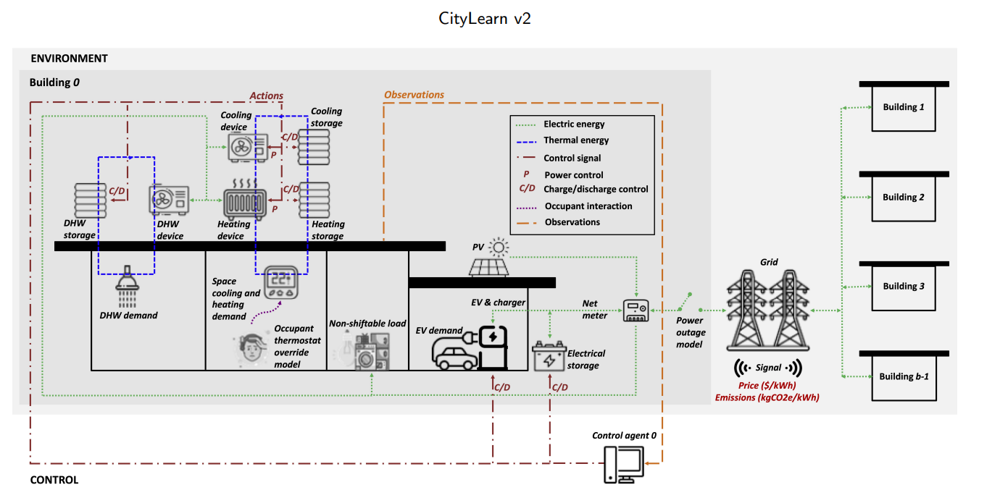
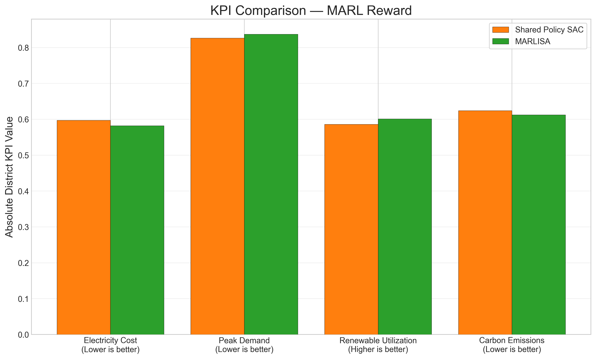
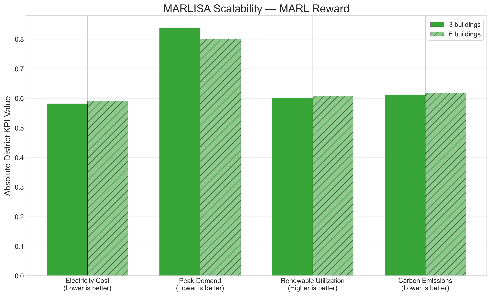
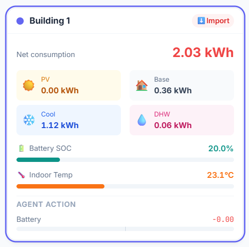
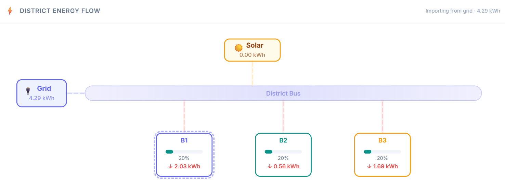
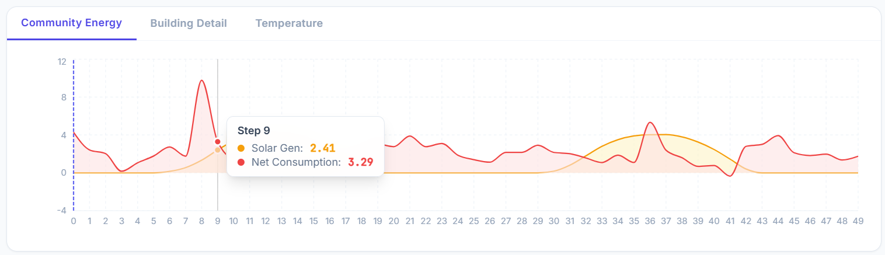
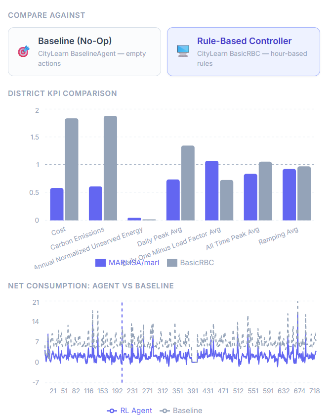
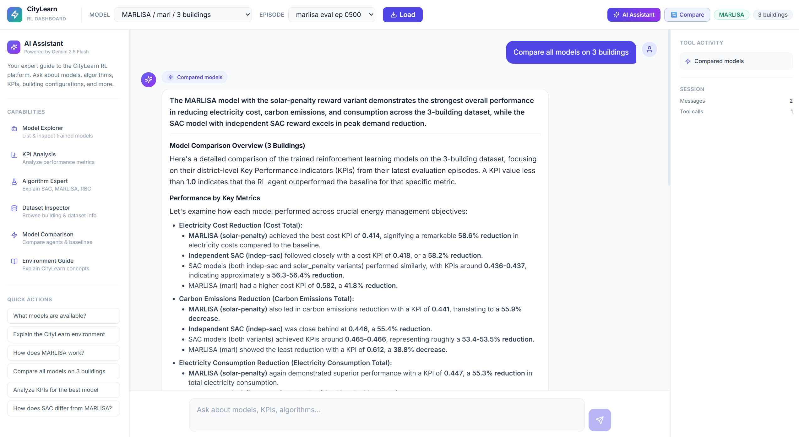
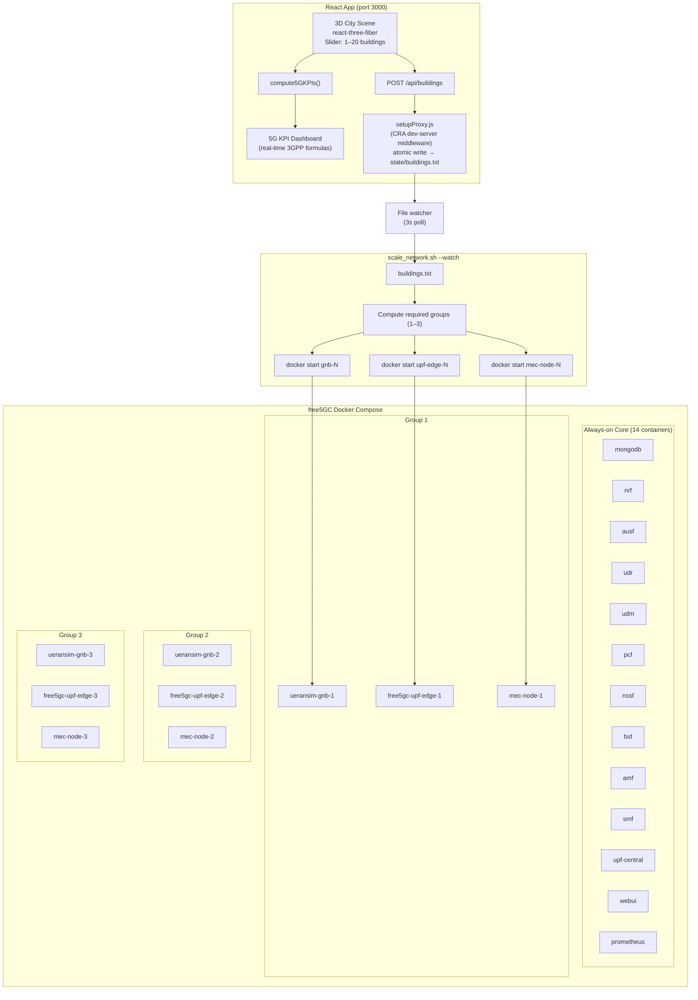

# Global Hackathon Submission

## Smart Cities & Renewable Energy - AI, 5G & Digital Power

## Shared Context

Our solution focuses on implementing reinforcement learning (RL) for district energy optimization over a scalable 5G network backbone.

Our main contribution is the integration of two technical streams into one smart-city system:

- an AI control stream (RL) that optimizes renewable energy usage, cost, carbon, and peak demand,
- a 5G digital-power stream that provides reliable, low-latency, and scalable urban connectivity.

In this document, we present both streams separately and then connect them as one unified architecture:

1. Part I: RL technical stream
2. Part II: 5G technical stream
3. Final conclusion on how both streams operate together
---

## Part I - RL 
# Multi-Agent Reinforcement Learning for Smart District Energy Optimization

For this hackathon submission to **Smart Cities & Renewable Energy - AI, 5G & Digital Power**, the work is framed around renewable energy integration in cities through AI-driven district control that supports sustainable urban infrastructure, intelligent mobility, and digital public services.

## Executive Summary

This document presents the reinforcement learning (RL) approach used to optimize district-level energy behavior in CityLearn v2.  
The core idea is simple: each building acts as an intelligent agent that learns how to use storage (cooling, domestic hot water, battery) to reduce cost, reduce carbon, reduce peak demand, and improve renewable energy usage.

The study compares three levels of coordination:

- Independent SAC (self-interested control)
- Shared Policy SAC (single shared policy across buildings)
- MARLISA-style coordination (shared learning plus lightweight coordination signals)

A key principle of this evaluation is strict fairness: algorithms are compared **only under the same reward function**.

For the companion poster version of this work, see: **DOI: 10.13140/RG.2.2.20274.26562**.

---

## 1. Motivation: Why This Problem Matters

Smart cities now combine distributed solar generation, battery systems, and flexible loads.  
The challenge is that these components are highly coupled in time and across buildings:

- Solar production is intermittent.
- Building demand patterns are heterogeneous.
- Naive independent control can create district peaks and grid stress.

Traditional rule-based control often fails to handle this dynamic, high-dimensional decision process. RL is a natural fit because it learns operational policies directly from interaction with the environment and long-term feedback.

---

## 2. RL Fundamentals for This Project

At every simulation step:

1. The environment provides each building with an observation.
2. The agent outputs an action (charge/discharge decisions).
3. The environment simulates the physical and economic consequences.
4. A reward is returned.
5. The agent updates its policy to maximize long-term cumulative reward.


In compact form, RL solves:

$$
\max_{\pi} \mathbb{E}_{\pi}\left[\sum_{t=0}^{T-1}\gamma^t r_t\right]
$$

where:

- $\pi$ is the policy (decision rule),
- $r_t$ is the reward at time $t$,
- $\gamma$ balances short-term and long-term outcomes.

---

## 3. How CityLearn Formulates the Energy Control Task

CityLearn is a realistic physics-based simulation platform that models a district as a set of buildings connected to a common grid.

Each building has:

- electric load and thermal demand profiles,
- PV generation,
- cooling storage,
- DHW storage,
- electrical battery storage.




### Observation

Each agent receives local building and context information (for example storage state, demand context, and external signals).

### Action

Each building controls three continuous actuators:

- Cooling storage action
- DHW storage action
- Electrical battery action

Actions are continuous and bounded (charge/discharge behavior).

### Transition

CityLearn advances the physical simulation one step and updates building/district states.

### Reward

The reward function defines what behavior is encouraged.  
This is the most important design lever in multi-agent energy control.

### Evaluation

Performance is evaluated using district KPIs:

- Electricity Cost (lower is better)
- Peak Demand (lower is better)
- Renewable Utilization (higher is better target at concept level)
- Carbon Emissions (lower is better)

---

## 4. Algorithm Families Compared

## 4.1 Independent SAC

Independent SAC trains one policy per building agent.

Conceptually:

- each building optimizes its own decision process,
- no explicit information sharing between agents,
- serves as the baseline for fully decentralized behavior.

Strength:

- simple and robust baseline.

Weakness:

- often misses district-level coordination opportunities.

## 4.2 Shared Policy SAC

Shared Policy SAC uses one common policy across all agents.

Conceptually:

- all buildings share model parameters,
- learning is data-efficient due to shared experience,
- execution is still decentralized (each building acts from local input).

Strength:

- better sample efficiency than fully independent training.

Weakness:

- without coordination-aware reward signals, shared parameters alone do not guarantee cooperative district behavior.

## 4.3 MARLISA-Style Coordination

MARLISA-style control adds lightweight coordination context to each agent.

Conceptually:

- each agent receives local state plus compact coordination cues,
- these cues help agents anticipate district-level consequences of local actions,
- coordination emerges without requiring a heavy centralized controller.

Strength:

- improved cooperative decision quality with low extra complexity.

Weakness:

- still sensitive to reward design and scenario distribution.

---

## 5. Reward Engineering (Detailed)

Reward design is the central experimental axis of this project.  
Three reward families are evaluated.

### Why reward engineering is critical in MARL

In multi-agent systems, each agent only controls a local actuator set, but the grid experiences the **sum** of all actions.  
Because of this, reward choice determines whether agents behave as:

- isolated optimizers, or
- cooperative contributors to district stability.

A small reward change can shift behavior from "locally good but globally harmful" to "locally acceptable and globally efficient."

## 5.1 Independent Reward (`indep`)

Behavior encouraged:

- each building minimizes its own net consumption objective.

In practice, each building is rewarded mainly from its own grid interaction, with no explicit district-level cooperation term.

Expected effect:

- stable local strategies,
- limited district-level cooperation.

Interpretation:

- this is the selfish baseline to test whether algorithmic sharing alone is enough.

Typical behavior pattern:

- the agent protects local storage for local needs,
- weak incentive to coordinate with neighboring buildings,
- district peaks may persist if many agents react similarly.

## 5.2 Solar Penalty Reward (`solar`)

Behavior encouraged:

- penalizes undesirable export behavior,
- pushes agents toward stronger local PV self-consumption.

This reward extends the independent objective by explicitly discouraging excessive export, so agents learn to retain and shift solar energy more effectively.

Expected effect:

- improved renewable usage patterns,
- potential improvement in cost and carbon if storage is used strategically.

Interpretation:

- introduces a stronger renewable-centric incentive while remaining decentralized.

Typical behavior pattern:

- midday PV is more likely to be stored locally instead of exported,
- batteries are used to shift solar energy to later high-demand periods,
- possible reduction in cost and carbon when storage timing is learned well.

## 5.3 MARL Reward (`marl`)

Behavior encouraged:

- explicit district-level coordination objectives (for example load smoothness/variance shaping).

This reward directly emphasizes district-level outcomes (for example smoother aggregate load, lower stress peaks, and better global energy behavior), so local actions are aligned with collective performance.

Expected effect:

- better collective behavior,
- lower district stress,
- stronger potential gains in district KPIs under cooperative policies.

Interpretation:

- this reward family is designed to align local actions with district outcomes.

Typical behavior pattern:

- agents avoid synchronized charge/discharge that creates demand spikes,
- storage actions are distributed over time to flatten aggregate load,
- district KPIs improve even if individual local actions look less greedy.

### Intuition across the three rewards

1. `indep`: "Help my own building."
2. `solar`: "Help my own building and avoid poor PV export behavior."
3. `marl`: "Act so the whole district behaves better."

### Why Reward-Isolated Comparison Is Mandatory

Comparing different algorithms under different rewards is not a fair test.  
This study therefore compares models only within reward-matched groups:

- `indep` group: Indep SAC vs Shared SAC
- `solar` group: Shared SAC vs MARLISA
- `marl` group: Shared SAC vs MARLISA

---

## 6. Experimental Design

Benchmarks:

- 3-building district: `citylearn_challenge_2023_phase_2_local_evaluation`
- 6-building district: `citylearn_challenge_2023_phase_3_3` (scalability test)

Run matrix:

| Algorithm | Reward | Buildings |
|---|---|---|
| Indep SAC | indep | 3 |
| Shared SAC | indep | 3 |
| Shared SAC | solar | 3 |
| Shared SAC | marl | 3 |
| MARLISA | solar | 3 |
| MARLISA | marl | 3 |
| MARLISA | marl | 6 |

Artifacts used:

- Training curves (TensorBoard reward traces)
- Final KPI snapshots (district-level CityLearn exports)

---

## 7. Results and Technical Interpretation

## 7.1 Section 1: Independent Reward


Interpretation:

- This section tests whether policy sharing alone helps when incentives remain selfish.
- Similar trends indicate that reward structure, not only parameter sharing, drives district behavior.

## 7.2 Section 2: Solar Penalty Reward


Interpretation:

- Under a solar-focused incentive, MARLISA-style coordination improves quality of control decisions.
- Gains appear in evaluation KPIs even when learning curves are close.

## 7.3 Section 3: MARL Reward




Interpretation:

- Coordination-focused reward plus coordination-aware policy structure is the strongest combination in this study.
- This section captures the best-performing cooperative regime.

## 7.4 Section 4: Scalability (MARLISA, MARL Reward)



Interpretation:

- The best configuration is transferred from 3 to 6 buildings.
- Results suggest the approach scales without requiring a new control architecture.

---

## 8. Key Takeaways

1. Reward design is the dominant factor in district-level behavior quality.
2. Shared learning improves efficiency, but does not automatically produce cooperation.
3. Lightweight coordination signals can provide meaningful gains without full centralization.
4. The MARLISA + MARL reward setting is the strongest candidate for larger districts.


---

## 9. Virtual Agent Assistant

### 9.1 Role and Objectives

The platform includes a conversational AI assistant that serves as an expert analyst for the CityLearn RL system. Its role is to make trained models, KPI results, and algorithmic concepts accessible to non-expert users through natural language interaction.

The assistant is powered by **Google Gemini 2.5 Flash** via the **Agno agent framework**, and is equipped with 10 purpose-built tools that expose the full platform data layer. Rather than displaying raw data, it translates tool outputs into structured, human-readable prose — acting as a senior analyst who presents polished briefings.

Core objectives:

- **Model exploration**: List all trained models, inspect metadata (algorithm, reward variant, policy type, checkpoints), and explain training configurations.
- **Performance analysis**: Retrieve and interpret normalized KPI metrics for any episode, comparing RL agents against no-op and rule-based baselines.
- **Cross-model comparison**: Compare all models on the same dataset side by side, highlighting which algorithm–reward combination performs best.
- **Education**: Explain the CityLearn environment, SAC, MARLISA, and RBC algorithms, observation/action spaces, and reward functions on demand.
- **Building and dataset inspection**: Surface per-building equipment specs (PV capacity, battery size, cooling/DHW devices) and dataset configuration details.

### 9.2 Architecture and Interaction Flow

The assistant follows a **tool-augmented generation** pattern:

1. The user sends a natural language query via the chat panel.
2. The **FastAPI backend** (`POST /api/chat`) forwards the message to the Agno agent.
3. The agent's system prompt instructs it to call the appropriate tool(s) before answering — ensuring responses are always grounded in actual platform data.
4. Tool functions execute against the model discovery layer (`config.py`) and episode data loader (`data.py`), returning structured JSON internally.
5. The agent synthesizes tool outputs into narrative prose with headings, bullet points, and bold highlights, following strict formatting guidelines in its system prompt.
6. The response is returned to the frontend, which renders it with Markdown support and displays tool call badges (e.g., "Analyzed KPIs", "Compared models") so the user can see which data sources were consulted.

**Available tools:**

| Tool | Purpose |
|---|---|
| `list_trained_models` | Catalog all discovered models with algorithm, reward, episodes, checkpoints |
| `get_model_details` | Full metadata and training config for a specific model |
| `get_episode_kpis` | Normalized KPI metrics for a given episode |
| `get_episode_summary` | Timeseries summary statistics (consumption, solar, COâ‚‚, cost, per-building battery usage) |
| `compare_models` | Cross-algorithm KPI comparison on the same dataset |
| `get_building_info` | Per-building equipment specs (PV, battery, cooling, DHW) |
| `get_dataset_info` | Dataset schema, building list, simulation parameters |
| `explain_citylearn` | Comprehensive explanation of the CityLearn environment |
| `explain_algorithm` | Detailed explanation of SAC, MARLISA, or RBC |
| `get_baseline_comparison` | Side-by-side KPI comparison of an RL model vs. a baseline agent |

### 9.3 Safety, Guardrails, and User Experience

**Data-grounded responses**: The system prompt mandates that the agent call tools to fetch actual numbers before answering performance questions, preventing hallucinated metrics.

**Clean output**: A post-processing pipeline strips raw JSON artifacts, tool-call noise (e.g., `Running: func_name(...)` lines), and excessive whitespace from agent responses before they reach the frontend, ensuring the user only sees polished prose.

**Structured formatting**: The system prompt enforces a strict response style — one-sentence summary lead, organized headings, bullet points, bold highlights for key numbers, and a closing takeaway. KPI values are always contextualized (e.g., "a cost KPI of **0.82** means an **18% reduction** vs. baseline").

**Tool call transparency**: Each tool invocation is surfaced in the chat UI as a labeled badge with a contextual icon (e.g., a bar-chart icon for "Analyzed KPIs", a flask icon for "Explained algorithm"), so users understand what data the assistant consulted.

**Graceful error handling**: If a model or episode is not found, tools return descriptive error messages listing available options, allowing the agent to guide the user to valid queries.

**Conversation modes**: The chat panel supports both a popup overlay (for quick questions while viewing the dashboard) and a fullscreen mode (for extended analytical conversations), togglable via a header button.

---

## 10. UI Screenshots and User Journey

### 10.1 Main Screenshots

**Screenshot 1 — Landing State: Model and Episode Selection**


The initial view presented when the dashboard loads. The header bar shows the CityLearn branding, a model selector dropdown (listing all discovered models in `ALGORITHM / reward_variant / N buildings` format), an episode selector, and a Load button. The center area displays an empty-state prompt: *"Select a trained model and episode above, then click Load to visualize the RL agent's energy management decisions across a multi-building district."*

---

**Screenshot 2 — Main Dashboard: Three-Panel Layout**


The primary operational view after loading an episode. A three-column layout: the left sidebar shows environment controls (building selection, dataset info, available baselines); the center panel displays the energy flow Sankey diagram, the building grid with per-building state cards, and community-level consumption/solar timeseries charts; the right panel shows the KPI panel with six normalized metric cards and a bar chart, plus the agent information panel with policy type and training configuration.

---

**Screenshot 3 — Building Grid: Per-Building State Cards**



A grid of building cards within the center panel. Each card shows the building name, real-time battery state-of-charge (SOC), net consumption, and indoor temperature. Cards are color-coded based on metric values (e.g., green for healthy SOC, red for high consumption), giving a quick visual overview of the district state at the current timestep.

---

**Screenshot 4 — Energy Flow: Sankey Diagram**



A Sankey-style energy flow visualization showing how energy moves through the district at each timestep — from solar generation through battery storage to grid import/export. Displays per-building and community-level energy balances, making it easy to see which buildings are charging, discharging, or drawing from the grid.

---

**Screenshot 5 — Community Charts: District-Level Timeseries**



Line and area charts showing district-level timeseries data over the full episode. Includes net consumption over time, solar generation overlay, and peak demand indicators. These charts reveal the aggregate impact of the RL agents' coordinated (or uncoordinated) storage actions on district load shape.

---

**Screenshot 6 — KPI Panel: Performance Metrics**


The right-sidebar KPI panel showing six normalized performance metrics: cost, carbon emissions, electricity consumption, peak demand, daily peak, load factor, and ramping. Each metric is displayed as a card with the normalized value and a color-coded interpretation (green when < 1.0, indicating the RL agent outperforms the no-op baseline). A bar chart below provides a visual comparison of all KPIs at a glance.

---

**Screenshot 7 — Playback Bar: Timeline Scrubber**


A bottom-docked playback control bar for stepping through the episode timeline. Includes play/pause controls, a speed adjustment slider (milliseconds per timestep), a timeline scrubber showing the current timestep position, and a timestamp display. Enables animated replay of the full episode to observe how agent decisions evolve over time.

---

**Screenshot 8 — Comparison Mode: Model vs. Baseline**



The comparison panel activated via the header toggle. The right sidebar expands to show side-by-side KPI tables comparing the loaded RL model against a baseline agent (no-op or RBC). Delta calculations highlight improvements or regressions for each metric. Users can also load a second trained model for agent-vs-agent comparison.

---

**Screenshot 9 — AI Assistant: Chat Panel (Popup Mode)**


The AI assistant chat panel in popup mode, floating over the main dashboard content. Shows a conversation with user/assistant message bubbles, Markdown-rendered responses with headings and bullet points, and tool call badges (e.g., "Analyzed KPIs", "Compared models") displayed as labeled pills with contextual icons. A text input field and send button are anchored at the bottom.

---

**Screenshot 10 — AI Assistant: Chat Panel (Fullscreen Mode)**



The AI assistant in fullscreen mode, replacing the main dashboard content for extended analytical conversations. The wider layout provides more reading space for detailed responses. A toggle button in the header switches between popup and fullscreen modes. The conversation thread, tool call badges, and Markdown formatting are identical to popup mode but scaled for the larger viewport.

### 10.2 User Flow Annotations

A typical user journey through the dashboard follows this sequence:

1. **Select model** — Choose an algorithm/reward/dataset combination from the header dropdown (e.g., `MARLISA / marl / 3 buildings`).
2. **Select episode** — Pick an evaluation episode from the episode dropdown (e.g., `marlisa_eval_ep_0200`).
3. **Load** — Click the Load button. The backend fetches and merges CSV data; the dashboard transitions from the landing state to the three-panel layout.
4. **Explore buildings** — Review per-building cards in the building grid. Click a building in the left sidebar to highlight it. Inspect battery SOC, consumption, and temperature.
5. **Analyze energy flows** — Examine the Sankey diagram to understand how solar energy is routed through storage to offset grid demand.
6. **Review district performance** — Scroll to the community charts to see aggregate consumption profiles and solar generation over the episode timeline.
7. **Check KPIs** — Review the right-panel KPI cards to see how the agent performs vs. the baseline across cost, carbon, peak demand, and other metrics.
8. **Playback** — Use the playback bar to animate the episode and watch how agent decisions evolve hour by hour across the simulation period.
9. **Compare** — Toggle comparison mode to load a baseline or competing model and view side-by-side KPI deltas.
10. **Ask the assistant** — Open the AI chat panel to ask natural language questions (e.g., "How does MARLISA compare to SAC on the 3-building dataset?" or "Which model has the lowest peak demand?").

### 10.3 Demo Script Notes

**Opening (30s)**: Start at the landing screen. Briefly explain the platform purpose — multi-agent RL for district energy optimization using CityLearn.

**Model loading (30s)**: Select `MARLISA / marl / 3 buildings`, pick the latest episode, and click Load. Point out the three-panel layout as it appears.

**Building exploration (45s)**: Walk through the building grid cards. Highlight how different buildings have different battery utilization patterns. Show the energy flow Sankey diagram to illustrate solar-to-battery-to-grid flows.

**District analysis (45s)**: Scroll to community charts. Point out how MARLISA's coordination smooths the aggregate load profile compared to uncoordinated baselines. Show the KPI panel — highlight that key metrics are below 1.0, confirming the agent outperforms the no-op baseline.

**Playback (30s)**: Hit play on the playback bar. Animate a few timesteps to show how building states, energy flows, and KPIs update in real time.

**Comparison (45s)**: Toggle comparison mode. Load the RBC baseline. Walk through the side-by-side KPI table, pointing out where MARLISA achieves the largest improvements (e.g., peak demand, cost).

**AI Assistant (60s)**: Open the chat panel. Ask: *"Compare all models on the 3-building dataset."* Show how the assistant calls `compare_models`, displays tool call badges, and returns a structured prose response with a clear verdict. Follow up with: *"Explain how MARLISA coordination works."* Show the `explain_algorithm` tool being invoked and the educational response.

**Closing (15s)**: Summarize key takeaway — reward design plus lightweight coordination (MARLISA + MARL reward) yields the strongest district-level performance, and the platform makes these results explorable and explainable.

---

## 11. References

1. Vazquez-Canteli et al. MARLISA: Multi-Agent RL with Iterative Sequential Action Selection. BuildSys, 2021.  
2. Vazquez-Canteli and Nagy. CityLearn v1.0: An OpenAI Gym Environment for Demand Response. BuildSys, 2019.  
3. Haarnoja et al. Soft Actor-Critic: Off-Policy Maximum Entropy Deep RL. ICML, 2018.  
4. Nweye et al. CityLearn 2022 Challenge: Citywide MARL for Demand Response. NeurIPS Competition, 2022.  
5. Nweye et al. CityLearn v2: A Multi-Agent Reinforcement Learning Environment for Home Energy Management and Demand Response. arXiv:2405.03848, 2024.  
6. CityLearn Documentation: https://www.citylearn.net/


---

## Part II - 5G 

# CityLearn — 5G Smart City Digital Twin

[](https://reactjs.org)
[](https://threejs.org)
[](https://free5gc.org)
[](https://docker.com)
[](LICENSE)

> Implementing 5G across a smart city is not an easy task, because different use cases impose conflicting KPIs. For example, connected smart vehicles need an uRLLC (Ultra-Reliable Low Latency Communication) slice targeting end-to-end latencies on the order of 1 ms, smart homes produce massive sensor traffic that requires an mMTC (Massive Machine Type Communications) slice optimized for device density and uplink efficiency, and remote learning or media demand eMBB (Enhanced Mobile Broadband) slices that prioritize throughput and spectral efficiency. That’s why we built CityLearn — a real-time 5G infrastructure digital twin that scales with your city, updates KPIs when you add or remove smart city buildings, and recommends the most optimized 5G architecture, with the optimized set of gNBs, UPFs and MEC compute nodes to satisfy the three slice profiles of your 5G. The platform is integrated with a live 5G core (free5gc) so you can watch containerized network functions start, fail, and recover, while scientifically grounded KPI calculations based on 3GPP models run and change in real time.

> As a result, Our solution provided an optimized 5G architecture for smart city use cases involving up to 20 smart city buildings as a proof of concept, ensuring that the resulting KPIs satisfy key 5G performance constraints.


---

## Table of Contents

- [Overview](#overview)
- [Novelty and Key Contributions](#novelty-and-key-contributions)
- [Architecture](#architecture)
  - [System Overview](#system-overview)
  - [5G Network Design](#5g-network-design)
  - [Data Flow](#data-flow)
  - [Scaling Table](#scaling-table)
- [5G KPI Engine](#5g-kpi-engine)
  - [KPI 1 Cell Capacity](#kpi-1-cell-capacity)
  - [KPI 2 Average UE Throughput](#kpi-2-average-ue-throughput)
  - [KPI 3 Latency](#kpi-3-latency)
  - [KPI 4 Packet Loss](#kpi-4-packet-loss)
  - [KPI 5 Connection Density](#kpi-5-connection-density)
- [Project Structure](#project-structure)
- [Prerequisites](#prerequisites)
- [Quick Start](#quick-start)
- [Demo Walkthrough](#demo-walkthrough)
- [Configuration Reference](#configuration-reference)
- [Troubleshooting](#troubleshooting)

---

## Overview

**CityLearn** bridges the gap between a 3D smart-city simulation and a real, running 5G core network integrated directly within it. While most digital twins are purely visual, CityLearn’s 3D environment acts as a **live control plane**. By simply modifying the number of smart city buildings in the city, the platform automatically provisions and deprovisions Docker containers running the 5G infrastructure, including the 5G Standalone (SA) core from [free5GC](https://free5gc.org), gNB simulators using [UERANSIM](https://github.com/aligungr/UERANSIM), and custom MEC nodes.

Simultaneously, a **physics-based 5G KPI engine** computes five core network metrics in real time using 3GPP-specified formulas — peak cell capacity, average UE throughput, per-slice latency, packet loss, and connection density — every time the building configuration changes.

**Stack at a glance:**

| Layer | Technology |
|---|---|
| 3D Visualization | React 18 + react-three-fiber + Three.js + Framer Motion |
| 5G Core | free5GC v3 (AMF, SMF, UPF, NRF, AUSF, UDM, PCF, NSSF) |
| RAN Simulator | UERANSIM gNB x3 (one per slice) |
| Edge Compute | Custom MEC nodes co-located per gNB |
| Infra Orchestration | Docker Compose + Bash/Python auto-scaler |
| State Bridge | CRA setupProxy.js middleware — no separate backend |

---

## Novelty and Key Contributions

1. **Zero-backend infrastructure bridge** — The React dev-server middleware (`setupProxy.js`) intercepts `POST /api/buildings`, atomically writes `state/buildings.txt`, and the watching shell script provisions Docker containers. No Express server, no database, no message queue needed.

2. **Real-time 3GPP-compliant KPI engine** — All five KPIs are derived from closed-form 3GPP formulas (TS 38.306, TR 38.913, TS 38.214), not mock data or random numbers. Changing one building updates all KPIs within the same React render cycle.

3. **Demand-driven 5G infrastructure scaling** — The city UI is the actual control plane. Slider to file to Docker: the 5G infrastructure responds to UI events, demonstrating intent-based network management.

4. **Scientifically optimised radio parameters** — 64T64R Massive MIMO, 8-layer MU-MIMO spatial multiplexing, 256-QAM, DDDSU TDD frame, n78 100 MHz producing a verified **3,472 Mbps peak per gNB**, **2.1 ms eMBB latency**, and **0.879 ms URLLC latency**.

---

## Architecture

### System Overview



### 5G Network Design

Architecture: **5G Standalone (SA)** + **Multi-access Edge Computing (MEC)** + **Network Slicing**

| Network Function | Role |
|---|---|
| AMF | Access and Mobility Management |
| SMF | Session Management — selects edge UPF per slice |
| UPF central | Always-on traffic anchor |
| UPF edge 1-3 | Local breakout at gNB site, less than 2 ms MEC latency |
| NRF | Service discovery for all NFs |
| AUSF / UDM / UDR | Authentication and subscriber data |
| PCF / NSSF | Policy and slice selection |
| UERANSIM gNB | Simulated NR base station (one per 8 buildings) |
| MEC node | Edge compute co-located with gNB (Nginx container) |

**Three network slices (3GPP TS 23.501):**

| Slice | SST | Use Case | Latency Target | Reliability |
|---|---|---|---|---|
| eMBB | 1 | Dashboards, video | less than 4 ms | 99.99% |
| URLLC | 2 | Grid control, safety | less than 1 ms | 99.999% |
| mMTC | 3 | IoT sensors, meters | less than 10 ms | — |

### Data Flow

```
[React slider] --> useState(buildingCount)
   --> useBuildingSync (debounce 500ms, AbortController)
         --> POST /api/buildings  { buildings: N }
               --> setupProxy.js (Express middleware inside npm start)
                     --> atomic write --> ./state/buildings.txt
                           --> scale_network.sh --watch (polls every 3s)
                                 --> docker start/stop containers
```

### Scaling Table

Per **3GPP TR 38.913** urban micro-cell, one gNB per 8 buildings (ISD ~300 m):

| Buildings | Active gNBs | Edge UPFs | MEC Nodes | Containers Started |
|---|---|---|---|---|
| 0 | 0 | 0 | 0 | — |
| 1 to 8 | 1 | 1 | 1 | Group 1 (3 containers) |
| 9 to 16 | 2 | 2 | 2 | Groups 1+2 (6 containers) |
| 17 to 20 | 3 | 3 | 3 | Groups 1+2+3 (9 containers) |

---

## 5G KPI Engine

All KPIs are computed in `src/pages/HomePage.jsx` using the `PHY` constants object and five pure functions. Values update on every `buildingCount` change within a single React `useMemo` call.

**Radio configuration (optimised):**

| Parameter | Value | Specification |
|---|---|---|
| Band | n78 (3.3-3.8 GHz TDD) | 3GPP TS 38.101-1 |
| Channel BW | 100 MHz | — |
| Numerology | mu=1, SCS=30 kHz | 3GPP TS 38.211 |
| PRBs | 273 | 3GPP TS 38.101-1 Table 5.3.2-1 |
| MIMO | 64T64R gNB / 4T4R UE | — |
| DL layers | 8 (MU-MIMO ZF) | 3GPP TR 38.306 |
| Modulation | 256-QAM (Q_m=8) | — |
| Max code rate | R_max = 948/1024 | 3GPP TS 38.214 Table 5.1.3.1-2 |
| TDD DL ratio | 74.3% (DDDSU) | 3GPP TR 38.211 |
| Scheduler efficiency | 78% | 3GPP system-level sims |

### KPI 1 Cell Capacity

**Formula (3GPP TR 38.306 s4.1.2):**

```
R_peak = layers x Q_m x R_max x N_RB x 12 x f_slot x TDD_DL x (1 - OH_DL)
```

where layers=8, f_slot=2000 slots/s (mu=1), OH_DL=14% overhead.

**Verified result:** 3,472 Mbps peak per gNB · 2,708 Mbps effective (x0.78 scheduler efficiency)

### KPI 2 Average UE Throughput

**Formula:**

```
T_avg  = (C_eff / N_active) x G_PF
G_PF   = 1 + 0.40 x ln(N_active) / ln(100)
```

Proportional-Fair scheduler multi-user diversity gain. N_active = buildings x 50 devices x 10% active ratio.

### KPI 3 Latency

**Composed formula (one-way UE to MEC):**

```
L_total = T_prop + T_tx + T_proc + T_queue

T_prop  = (ISD/2)/c + T_fiber          [propagation + fiber hop]
T_tx    = T_slot = 0.5 ms              [2-sym mini-slot for URLLC = 0.071 ms]
T_proc  = N2 x T_sym + T_MEC           [gNB decode + edge compute]
T_queue = T_slot x rho / (2(1-rho))    [M/D/1 queuing model]
```

**Verified results:**

| Slice | Total Latency |
|---|---|
| eMBB | 2.117 ms |
| URLLC | 0.879 ms |
| mMTC | approx 3 ms |

### KPI 4 Packet Loss

**Formula:**

```
P_loss    = P_HARQ + P_overflow
P_HARQ    = BLER_0 ^ H_rounds          [Chase-Combining HARQ residual]
P_overflow = 0         for rho < 0.80
           = (rho-0.80)^2 x 5          for rho >= 0.80
```

**Verified results:** eMBB = 0.0100% (4 HARQ rounds) · URLLC = 0.1000% (single shot)

### KPI 5 Connection Density

**Formula:**

```
rho_conn = N_connected / (gNBs x A_hex)
A_hex    = (sqrt(3)/2) x ISD^2         [hexagonal cell area, ISD=300m]
```

**Verified result:** 3,935 UE/km^2 at 20 buildings / 3 gNBs · max theoretical 10^6 UE/km^2 (mMTC per 3GPP TR 38.913)

---

## Project Structure

```
5g/
+-- client/
|   +-- src/
|   |   +-- pages/
|   |   |   +-- HomePage.jsx         Main page + 5G KPI engine
|   |   +-- components/
|   |   |   +-- Building.jsx         3D building component
|   |   +-- hooks/
|   |   |   +-- useBuildingSync.js   Docker state sync hook
|   |   +-- setupProxy.js            CRA dev-server bridge (no backend)
|   +-- state/
|   |   +-- buildings.txt            Shared state file (UI -> scaler)
|   +-- scale_network.sh             Docker auto-scaler
|
+-- free5gc/
    +-- docker-compose.yml           Full free5GC + UERANSIM stack
    +-- scale.sh                     Production Docker scaler
    +-- state_server.py              Alternative state server
    +-- config/
    |   +-- amf/amfcfg.yaml
    |   +-- smf/smfcfg.yaml
    |   +-- upf/edge-{1,2,3}/       Per-gNB edge UPF configs
    |   +-- ueransim/gnb{1,2,3}.yaml
    |   +-- mec/mec{1,2,3}.conf
    +-- cert/                        TLS certificates for 5G NFs
```

---

## Prerequisites

| Requirement | Version | Notes |
|---|---|---|
| Node.js | 18 or higher | For React app |
| npm | 9 or higher | — |
| Docker | 24 or higher | With Compose v2 plugin |
| Docker Compose | v2 | Use `docker compose` not `docker-compose` |
| bash | 4 or higher | For scale script |
| RAM | 8 GB minimum | free5GC core uses ~4 GB |
| OS | Linux | free5GC requires Linux kernel with GTP module |

---

## Quick Start

### 1. Clone and Install

```bash
git clone https://github.com/<your-org>/citylearn-5g.git
cd citylearn-5g/client
npm install
npm install http-proxy-middleware
```

### 2. Start the React App

```bash
# From client/
npm start
```

Expected console output confirming the state bridge is active:
```
[citylearn-5g] proxy ready -- state file: /path/to/client/state/buildings.txt
```

The app will be available at **http://localhost:3000**

### 3. Launch the 5G Core

```bash
# From free5gc/
docker compose up --no-start

# Start always-on 5G core (14 containers)
docker compose up -d mongodb nrf ausf udr udm pcf nssf bsf \
                      amf smf upf-central webui prometheus

# Wait for NRF service discovery
sleep 15 && docker compose ps
```

### 4. Start the Auto-Scaler

```bash
# From free5gc/ — watches buildings.txt and scales Docker containers
./scale.sh --watch --file /absolute/path/to/client/state/buildings.txt
```

### 5. Verify the Bridge

```bash
# Test the full pipeline without touching the UI
curl -s -X POST http://localhost:3000/api/buildings \
     -H "Content-Type: application/json" \
     -d '{"buildings": 12}' | python3 -m json.tool

# Expected: { "buildings": 12, "synced": true }

# Verify state file was written
cat client/state/buildings.txt
# Expected: 12

# Wait 3-6s then check Docker
docker ps --format "table {{.Names}}\t{{.Status}}" | grep -E "gnb|upf-edge|mec"
# Expected: ueransim-gnb-1, free5gc-upf-edge-1, mec-node-1 (and -2) running
```

---

## Demo Walkthrough

1. **Drag the Buildings slider** (top-center) — the 3D city updates instantly.
2. **Watch the KPI Dashboard** (left panel) — all five 5G KPIs recalculate in real time. Hover any KPI block to expand its formula.
3. **Observe Docker** — within 3-6 seconds of crossing a group boundary (8 or 16 buildings), gNB + UPF + MEC containers start or stop.
4. **Click any building** — the right panel shows per-building KPIs with full latency breakdown.
5. **Open the "5G Arch" modal** — complete formula reference and slice specifications.

**Key thresholds:**

| Slider Position | gNBs | Docker Action |
|---|---|---|
| 1-8 buildings | 1 gNB | Group 1 starts (3 containers) |
| 9-16 buildings | 2 gNBs | Group 2 starts (+3 containers) |
| 17-20 buildings | 3 gNBs | Group 3 starts (+3 containers) |
| Decreasing | Fewer gNBs | Groups stop in reverse order |

---

## Configuration Reference

### Environment Variables

```bash
# Override state file location
CITYLEARN_STATE_FILE=/custom/path/buildings.txt npm start

# Scale script uses --file flag
./scale_network.sh --watch --file /custom/path/buildings.txt
```

### PHY Constants

All radio parameters are consolidated in the `PHY` object at the top of `HomePage.jsx`:

```js
const PHY = {
  BW_MHz       : 100,          // Channel bandwidth [MHz]
  N_RB         : 273,          // PRBs (3GPP TS 38.101-1)
  mu           : 1,            // Numerology (SCS = 30 kHz)
  Q_m          : 8,            // Modulation order (256-QAM)
  R_max        : 948 / 1024,   // Max code rate (3GPP TS 38.214)
  layers_DL    : 8,            // DL MIMO layers
  TDD_DL       : 0.743,        // DL time fraction (DDDSU)
  eta_sched    : 0.78,         // Scheduler efficiency
  ISD_m        : 300,          // Inter-site distance [m]
  GNB_PER_N    : 8,            // Buildings per gNB
  DEV_PER_BLDG : 50,           // Devices per building
}
```

---

## Troubleshooting

**setupProxy.js not activating**
```bash
npm install http-proxy-middleware
# Restart npm start and look for:
# [citylearn-5g] proxy ready -- state file: ...
```

**5G Core NFs failing to register with NRF**
```bash
docker logs free5gc-nrf --tail 30
# Wait 15-20s after startup before starting AMF/SMF
```

**Scale script not picking up changes**
```bash
cat client/state/buildings.txt   # Verify content
chmod +x scale_network.sh        # Ensure execute permission
```

**URLLC latency shows > 1 ms**
This is expected at high building counts where queue load rho > 0.1. The architecture target of < 1 ms assumes dedicated URLLC resource blocks with zero shared-queue contention.

---

*Built for Huawei DeGourdi Hackathon -- CityLearn Team*


---

## Smooth Conclusion

Together, these two parts form one integrated hackathon submission: RL provides intelligent district energy decisions, and 5G provides the resilient city-scale network layer needed to operationalize smart services.

In short: better renewable energy behavior, scalable urban infrastructure, mobility-ready connectivity, and a clear path toward digital public services.


