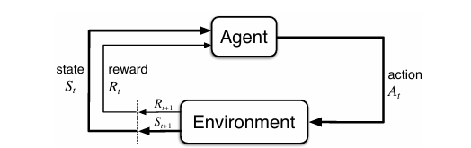
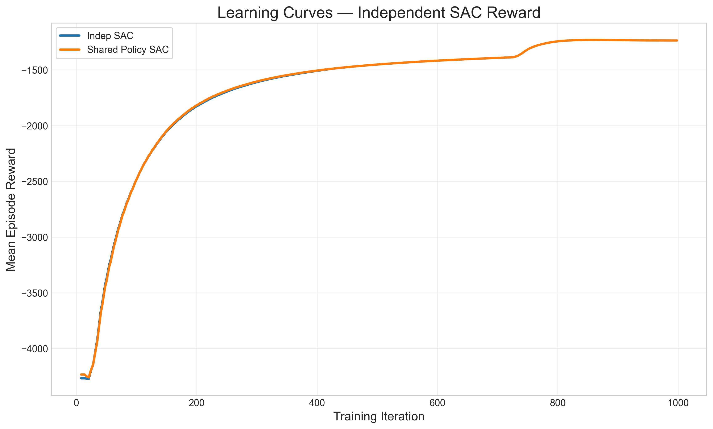
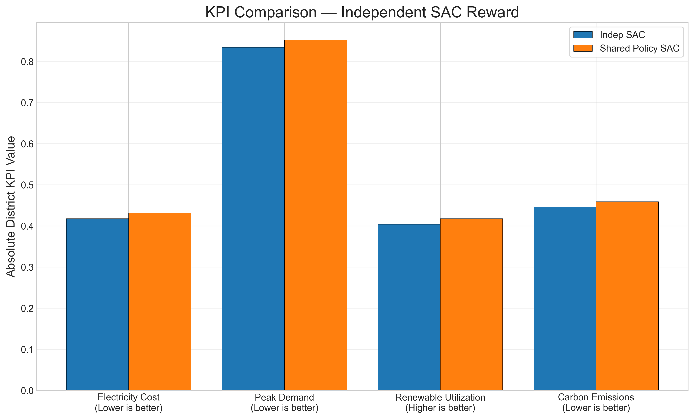
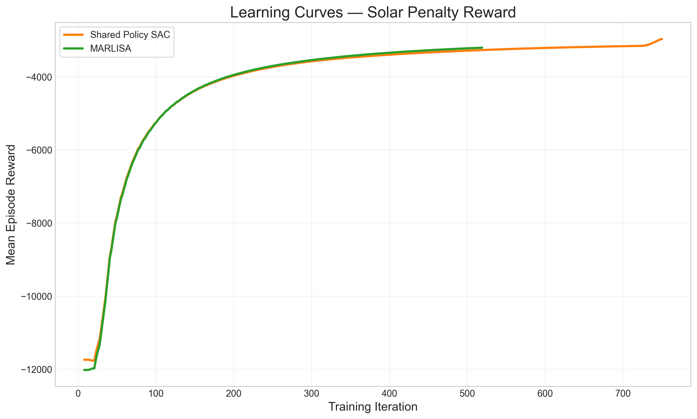
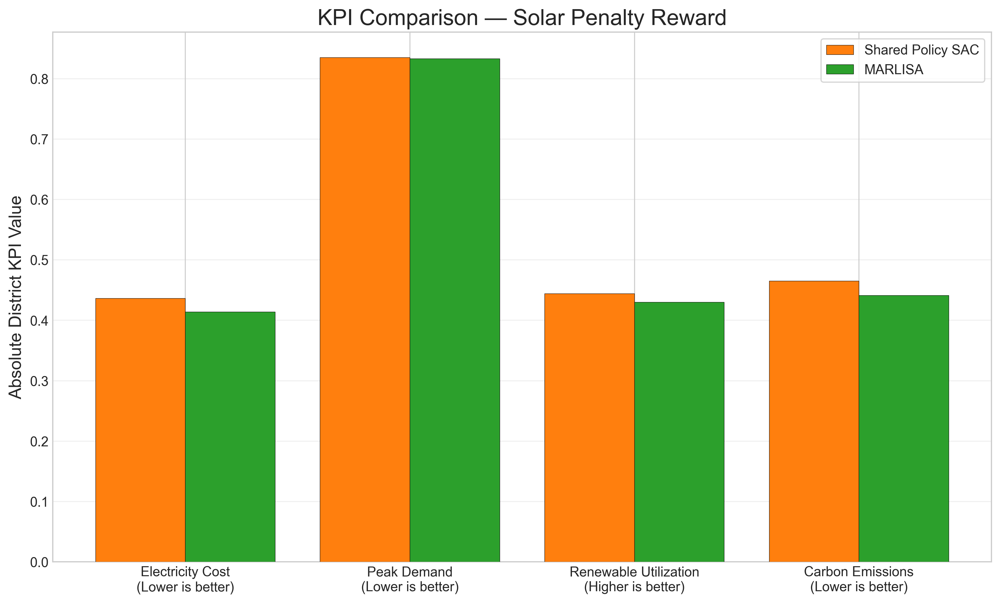
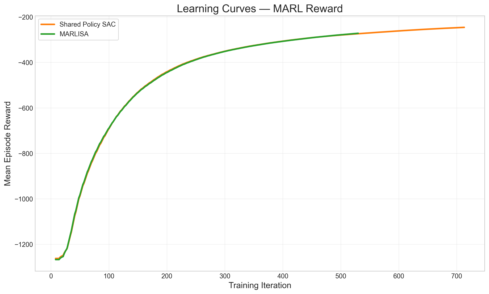

# Multi-Agent Reinforcement Learning for Smart District Energy Optimization

For this hackathon submission to **Smart Cities & Renewable Energy - AI, 5G & Digital Power**, the work is framed around renewable energy integration in cities through AI-driven district control that supports sustainable urban infrastructure, intelligent mobility, and digital public services.

## Executive Summary

This document presents the reinforcement learning (RL) approach used to optimize district-level energy behavior in CityLearn v2.  
The core idea is simple: each building acts as an intelligent agent that learns how to use storage (cooling, domestic hot water, battery) to reduce cost, reduce carbon, reduce peak demand, and improve renewable energy usage.

The study compares three levels of coordination:

- Independent SAC (self-interested control)
- Shared Policy SAC (single shared policy across buildings)
- MARLISA-style coordination (shared learning plus lightweight coordination signals)

A key principle of this evaluation is strict fairness: algorithms are compared **only under the same reward function**.

For the companion poster version of this work, see: **DOI: 10.13140/RG.2.2.20274.26562**.

---

## 1. Motivation: Why This Problem Matters

Smart cities now combine distributed solar generation, battery systems, and flexible loads.  
The challenge is that these components are highly coupled in time and across buildings:

- Solar production is intermittent.
- Building demand patterns are heterogeneous.
- Naive independent control can create district peaks and grid stress.

Traditional rule-based control often fails to handle this dynamic, high-dimensional decision process. RL is a natural fit because it learns operational policies directly from interaction with the environment and long-term feedback.

---

## 2. RL Fundamentals for This Project

At every simulation step:

1. The environment provides each building with an observation.
2. The agent outputs an action (charge/discharge decisions).
3. The environment simulates the physical and economic consequences.
4. A reward is returned.
5. The agent updates its policy to maximize long-term cumulative reward.

In compact form, RL solves:

$$
\max_{\pi} \mathbb{E}_{\pi}\left[\sum_{t=0}^{T-1}\gamma^t r_t\right]
$$

where:

- $\pi$ is the policy (decision rule),
- $r_t$ is the reward at time $t$,
- $\gamma$ balances short-term and long-term outcomes.

---

## 3. How CityLearn Formulates the Energy Control Task

CityLearn is a realistic physics-based simulation platform that models a district as a set of buildings connected to a common grid.

Each building has:

- electric load and thermal demand profiles,
- PV generation,
- cooling storage,
- DHW storage,
- electrical battery storage.

### Observation

Each agent receives local building and context information (for example storage state, demand context, and external signals).

### Action

Each building controls three continuous actuators:

- Cooling storage action
- DHW storage action
- Electrical battery action

Actions are continuous and bounded (charge/discharge behavior).

### Transition

CityLearn advances the physical simulation one step and updates building/district states.

### Reward

The reward function defines what behavior is encouraged.  
This is the most important design lever in multi-agent energy control.

### Evaluation

Performance is evaluated using district KPIs:

- Electricity Cost (lower is better)
- Peak Demand (lower is better)
- Renewable Utilization (higher is better target at concept level)
- Carbon Emissions (lower is better)

---

## 4. Algorithm Families Compared

## 4.1 Independent SAC

Independent SAC trains one policy per building agent.

Conceptually:

- each building optimizes its own decision process,
- no explicit information sharing between agents,
- serves as the baseline for fully decentralized behavior.

Strength:

- simple and robust baseline.

Weakness:

- often misses district-level coordination opportunities.

## 4.2 Shared Policy SAC

Shared Policy SAC uses one common policy across all agents.

Conceptually:

- all buildings share model parameters,
- learning is data-efficient due to shared experience,
- execution is still decentralized (each building acts from local input).

Strength:

- better sample efficiency than fully independent training.

Weakness:

- without coordination-aware reward signals, shared parameters alone do not guarantee cooperative district behavior.

## 4.3 MARLISA-Style Coordination

MARLISA-style control adds lightweight coordination context to each agent.

Conceptually:

- each agent receives local state plus compact coordination cues,
- these cues help agents anticipate district-level consequences of local actions,
- coordination emerges without requiring a heavy centralized controller.

Strength:

- improved cooperative decision quality with low extra complexity.

Weakness:

- still sensitive to reward design and scenario distribution.

---

## 5. Reward Engineering (Detailed)

Reward design is the central experimental axis of this project.  
Three reward families are evaluated.

### Why reward engineering is critical in MARL

In multi-agent systems, each agent only controls a local actuator set, but the grid experiences the **sum** of all actions.  
Because of this, reward choice determines whether agents behave as:

- isolated optimizers, or
- cooperative contributors to district stability.

A small reward change can shift behavior from "locally good but globally harmful" to "locally acceptable and globally efficient."

## 5.1 Independent Reward (`indep`)

Behavior encouraged:

- each building minimizes its own net consumption objective.

In practice, each building is rewarded mainly from its own grid interaction, with no explicit district-level cooperation term.

Expected effect:

- stable local strategies,
- limited district-level cooperation.

Interpretation:

- this is the selfish baseline to test whether algorithmic sharing alone is enough.

Typical behavior pattern:

- the agent protects local storage for local needs,
- weak incentive to coordinate with neighboring buildings,
- district peaks may persist if many agents react similarly.

## 5.2 Solar Penalty Reward (`solar`)

Behavior encouraged:

- penalizes undesirable export behavior,
- pushes agents toward stronger local PV self-consumption.

This reward extends the independent objective by explicitly discouraging excessive export, so agents learn to retain and shift solar energy more effectively.

Expected effect:

- improved renewable usage patterns,
- potential improvement in cost and carbon if storage is used strategically.

Interpretation:

- introduces a stronger renewable-centric incentive while remaining decentralized.

Typical behavior pattern:

- midday PV is more likely to be stored locally instead of exported,
- batteries are used to shift solar energy to later high-demand periods,
- possible reduction in cost and carbon when storage timing is learned well.

## 5.3 MARL Reward (`marl`)

Behavior encouraged:

- explicit district-level coordination objectives (for example load smoothness/variance shaping).

This reward directly emphasizes district-level outcomes (for example smoother aggregate load, lower stress peaks, and better global energy behavior), so local actions are aligned with collective performance.

Expected effect:

- better collective behavior,
- lower district stress,
- stronger potential gains in district KPIs under cooperative policies.

Interpretation:

- this reward family is designed to align local actions with district outcomes.

Typical behavior pattern:

- agents avoid synchronized charge/discharge that creates demand spikes,
- storage actions are distributed over time to flatten aggregate load,
- district KPIs improve even if individual local actions look less greedy.

### Intuition across the three rewards

1. `indep`: "Help my own building."
2. `solar`: "Help my own building and avoid poor PV export behavior."
3. `marl`: "Act so the whole district behaves better."

### Why Reward-Isolated Comparison Is Mandatory

Comparing different algorithms under different rewards is not a fair test.  
This study therefore compares models only within reward-matched groups:

- `indep` group: Indep SAC vs Shared SAC
- `solar` group: Shared SAC vs MARLISA
- `marl` group: Shared SAC vs MARLISA

---

## 6. Experimental Design

Benchmarks:

- 3-building district: `citylearn_challenge_2023_phase_2_local_evaluation`
- 6-building district: `citylearn_challenge_2023_phase_3_3` (scalability test)

Run matrix:

| Algorithm | Reward | Buildings |
|---|---|---|
| Indep SAC | indep | 3 |
| Shared SAC | indep | 3 |
| Shared SAC | solar | 3 |
| Shared SAC | marl | 3 |
| MARLISA | solar | 3 |
| MARLISA | marl | 3 |
| MARLISA | marl | 6 |

Artifacts used:

- Training curves (TensorBoard reward traces)
- Final KPI snapshots (district-level CityLearn exports)

---

## 7. Results and Technical Interpretation

## 7.1 Section 1: Independent Reward

Interpretation:

- This section tests whether policy sharing alone helps when incentives remain selfish.
- Similar trends indicate that reward structure, not only parameter sharing, drives district behavior.

## 7.2 Section 2: Solar Penalty Reward

Interpretation:

- Under a solar-focused incentive, MARLISA-style coordination improves quality of control decisions.
- Gains appear in evaluation KPIs even when learning curves are close.

## 7.3 Section 3: MARL Reward

Interpretation:

- Coordination-focused reward plus coordination-aware policy structure is the strongest combination in this study.
- This section captures the best-performing cooperative regime.

## 7.4 Section 4: Scalability (MARLISA, MARL Reward)

Interpretation:

- The best configuration is transferred from 3 to 6 buildings.
- Results suggest the approach scales without requiring a new control architecture.

---

## 8. Key Takeaways

1. Reward design is the dominant factor in district-level behavior quality.
2. Shared learning improves efficiency, but does not automatically produce cooperation.
3. Lightweight coordination signals can provide meaningful gains without full centralization.
4. The MARLISA + MARL reward setting is the strongest candidate for larger districts.

---

## 9. Placeholder: Virtual Agent Assistant (To Be Filled)

### 9.1 Role and Objectives

_To be completed by teammate_

### 9.2 Architecture and Interaction Flow

_To be completed by teammate_

### 9.3 Safety, Guardrails, and User Experience

_To be completed by teammate_

---

## 10. Placeholder: UI Screenshots and User Journey (To Be Filled)

### 10.1 Main Screenshots

_To be completed by teammate_

### 10.2 User Flow Annotations

_To be completed by teammate_

### 10.3 Demo Script Notes

_To be completed by teammate_

---

## 11. References

1. Vazquez-Canteli et al. MARLISA: Multi-Agent RL with Iterative Sequential Action Selection. BuildSys, 2021.  
2. Vazquez-Canteli and Nagy. CityLearn v1.0: An OpenAI Gym Environment for Demand Response. BuildSys, 2019.  
3. Haarnoja et al. Soft Actor-Critic: Off-Policy Maximum Entropy Deep RL. ICML, 2018.  
4. Nweye et al. CityLearn 2022 Challenge: Citywide MARL for Demand Response. NeurIPS Competition, 2022.  
5. Nweye et al. CityLearn v2: A Multi-Agent Reinforcement Learning Environment for Home Energy Management and Demand Response. arXiv:2405.03848, 2024.  
6. CityLearn Documentation: https://www.citylearn.net/
